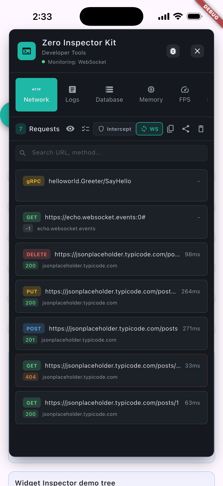
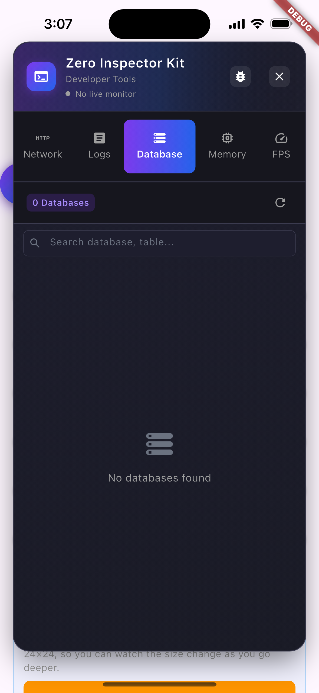
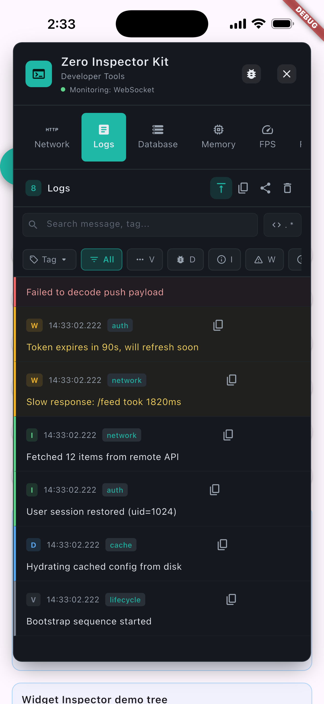
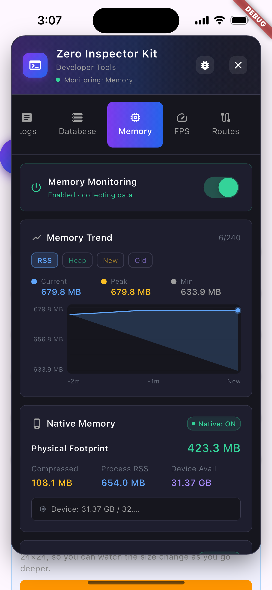
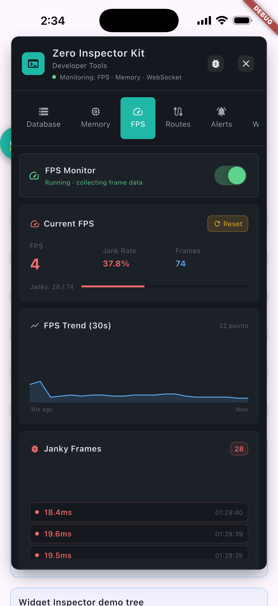
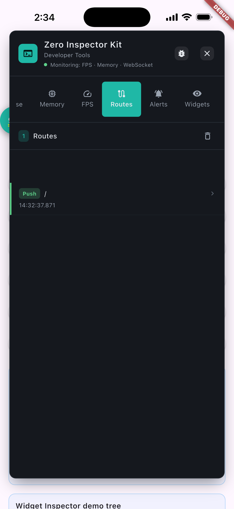
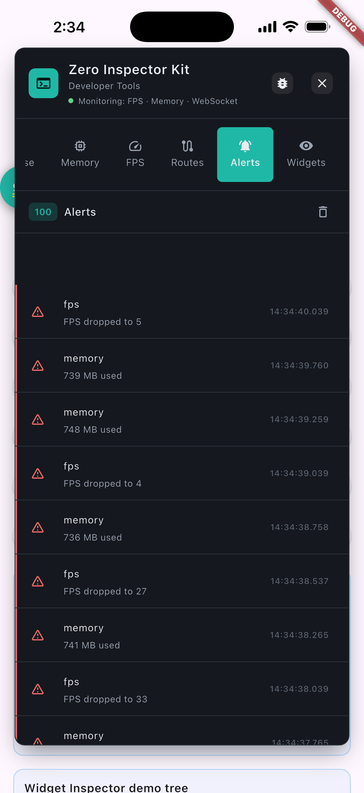
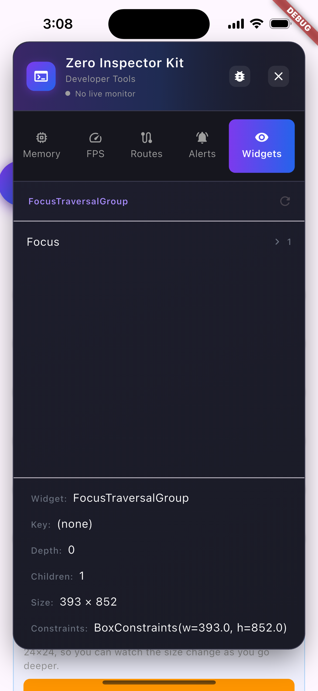

<div align="center">

# Zero Inspector Kit

</div>

<div align="center" style="display: flex; align-items: center; justify-content: center; gap: 36px;">


<span style="font-size: 1.1em; padding: 0 8px;"><a href="README.md">English</a> &nbsp;|&nbsp; <a href="README_zh.md">简体中文</a> &nbsp;|&nbsp; <strong>Deutsch</strong> &nbsp;|&nbsp; <a href="README_es.md">Español</a> &nbsp;|&nbsp; <a href="README_ja.md">日本語</a></span>


</div>

Eine In-App-Entwicklerkonsole für Flutter: Inspektion von HTTP-, WebSocket- und gRPC-Verkehr, Echtzeit-Überwachung von Protokollen, Datenbank, Speicherlecks und FPS, Routenverfolgung, Benachrichtigungen und Ein-Klick-Fehlerberichte – alles ohne die App zu verlassen. In Release-Builds automatisch deaktiviert.

[](https://pub.dev/packages/zero_inspector_kit)
[](https://pub.dev/packages/zero_inspector_kit/score)
[](https://github.com/zero-labsco/zero_inspector_kit/actions/workflows/ci.yml)
[](https://github.com/zero-labsco/zero_inspector_kit/blob/main/LICENSE)
[](https://pub.dev/packages/zero_inspector_kit)
[](https://flutter.dev)
[](https://dart.dev)
[](https://pub.dev/packages/effective_dart)

> **🔔 Upgrade empfohlen:** Dieses Release ergänzt `InspectorHttpOverrides` / `createInspectorHttpClient()` für die Erfassung innerhalb von `HttpOverrides.runWithHttpOverrides()`-Zonen sowie `reinstallHttpOverrides()` für Apps, die das globale Override nach der Init ersetzen, und macht Standard-Release-(AOT-)Builds wirklich inert. Allen Nutzern wird ein Upgrade auf die neueste Version (`^2.3.0`) empfohlen.

🌐 **[Offizielle Website](https://www.zerolabsco.com/)** &nbsp;·&nbsp; 📦 **[Auf pub.dev ansehen](https://pub.dev/packages/zero_inspector_kit)** &nbsp;·&nbsp; 🔗 **[Auf GitHub ansehen](https://github.com/zero-labsco/zero_inspector_kit)**

---

## Inhaltsverzeichnis

- [Funktionen](#funktionen)
- [Screenshots](#screenshots)
- [Installation](#installation)
- [Den Inspector in Release-Builds aktivieren](#den-inspector-in-release-builds-aktivieren)
- [Nutzung](#nutzung)
  - [Zero-Invasion-Integration (Empfohlen)](#zero-invasion-integration-empfohlen)
  - [Nicht-invasiv von Design](#nicht-invasiv-von-design)
  - [Protokollierung (Logging)](#protokollierung-logging)
  - [Fehlerüberwachung](#fehlerüberwachung)
  - [Sitzungspersistenz](#sitzungspersistenz)
  - [Netzwerkanfragen](#netzwerkanfragen)
  - [WebSocket / gRPC-Erfassung (standardmäßig deaktiviert)](#websocket--grpc-erfassung-standardmäßig-deaktiviert)
  - [Netzwerk-Anfrageinterceptor](#netzwerk-anfrageinterceptor)
  - [Datenbankanbieter](#datenbankanbieter)
  - [Speicherüberwachung](#speicherüberwachung)
  - [FPS-Überwachung](#fps-überwachung)
  - [Benutzerdefinierter Datenbankanbieter](#benutzerdefinierter-datenbankanbieter)
  - [Widget-Inspektor & Netzwerk-Zeitachse (standardmäßig aktiv)](#widget-inspektor--netzwerk-zeitachse-standardmäßig-aktiv)
- [API-Referenz](#api-referenz)
- [Mitwirken](#mitwirken)
- [Lizenz](#lizenz)

---

## Funktionen

- **Zero-Invasion-Integration** – Eine einzige Codezeile, keine Änderungen am bestehenden Projektcode.
- **Netzwerk-Inspektor** – Echtzeit-Erfassung aller HTTP-Anfragen (http & Dio); Modifikation von Body/Headern über Interceptor-Regeln; integrierter **Replay-Editor** (nur Query-Parameter editierbar – URL/Header/Body bleiben schreibgeschützt – mit Antwortvorschau); Batch-cURL-Kopie; Maskierung sensibler Header; filterbar nach Methode/Status/Abgefangen.
- **WebSocket / gRPC-Erfassung** – Optionale Erfassung von Streaming-Protokollen (standardmäßig deaktiviert, zur Laufzeit umschaltbar wie Speicher/FPS); WebSocket-Frames und gRPC-Aufrufe erscheinen in der Netzwerkliste.
- **Protokollierungssystem** – Erfasst automatisch `print()`, `debugPrint()` und benutzerdefinierte Logs über mehrere Stufen; Integration mit Drittanbieter-Log-Bibliotheken; Auto-Scroll (pausierbar), Regex-Suche, Tag-Filterung und Ein-Klick-Kopie eines einzelnen Log-Eintrags.
- **Fehlerüberwachung** – Dedizierter Errors-Tab (seit v1.9.0): hookt `FlutterError.onError` + `runZonedGuarded`, aggregiert und dedupliziert Abstürze nach Typ + Stack-Signatur mit Zähler sowie erstem/letztem Auftreten; ein rotes Zähler-Badge sitzt auf dem Errors-Tab-Icon; optionaler `onErrorReport`-Hook (seit v1.16.0) leitet aggregierte Fehler an Sentry / Firebase Crashlytics weiter.
- **Sitzungspersistenz** – Logs / Netzwerk / Fehler / **Warnungen** werden asynchron in die eigene Datenbank `zero_inspector_kit.db` des Inspektors geschrieben (seit v1.9.0; ein diskbasierter Ringpuffer, der auch im Database-Tab erscheint); beim Start werden Logs, Fehler und Warnungen in ihre Tabs wiedergegeben, und Netzwerkanfragen können ebenfalls wiedergegeben werden mit `init(enableNetworkReplay: true)` (seit v1.17.0); Export und Freigabe des vollständigen Sitzungsarchivs (nun inklusive Warnungen) aus dem Panel-Header.
- **Datenbank-Betrachter** – Inspektion von SQLite- und anderen Datenbanken über benutzerdefinierte Anbieter.
- **Speicherüberwachung** – Trenddiagramm, Dart-Heap, Native-Speicheraufschlüsselung, Lecksuche, Bild-Cache- & Speicherstatistiken sowie ein bedarfsweise abrufbares **Klassen-Allokations-Histogramm** (VM-Service `getAllocationProfile`, listet die größten Klassen nach belegten Bytes mit einem „+new“-Badge für seit dem letzten GC gewachsene Klassen). Alles hinter einem Hauptschalter zur Vermeidung von Overhead; tiefe Objektgraph-/Retaining-Pfad-Analyse bleibt offiziellen DevTools vorbehalten. Seit v1.9.0 brückt der Leckdetektor zusätzlich Flutters offizielles `FlutterMemoryAllocations`, um Falschmeldungen zu reduzieren.
- **FPS-Überwachung** – Echtzeit-FPS, Jank-Erkennung, Trenddiagramm, Frame-Datensätze mit **phasenweiser Build- + Raster-Zeitmessung** und einem **adaptiven Jank-Schwellenwert**, der aus der Bildwiederholfrequenz des Displays abgeleitet wird (damit 120-Hz-Bildschirme streng bleiben). Hauptschalter zur Vermeidung von Overhead.
- **Routen-Tracker** – Navigationsverlauf und aktuelle Route (`navigatorObservers: [InspectorRouteObserver()]`).
- **Warnungssystem** – Regelbasierte Warnungen zu Netzwerk/Logs/Speicher/FPS mit Ungelesen-Badge und Drosselung; Warnungen werden auf Datenträger persistiert und überstehen App-Neustarts.
- **Schwebender Button** – Overlay-Button mit Atem-Animation, der sich automatisch an Bildschirmränder andockt und Back-Geste-Konflikte vermeidet.
- **Ein-Klick-Fehlerbericht** – Tippen Sie auf das Fehler-Icon im Panel-Header, um eine sofort ablegbare Momentaufnahme (Gerätemodell + OS + aktueller Speicher + aktuelle Logs + aktuelle Netzwerkanfragen) über die System-Teilen-Funktion zu teilen.
- **Moderne UI** – Dunkles Theme mit Verläufen und zentralisierten, anpassbaren Farben.
- **Plattformübergreifend** – Android und iOS.

---

## Screenshots

> Klicken Sie auf eine Miniaturansicht, um das Bild in voller Größe zu öffnen.

| Netzwerk-Inspektor | Datenbank-Betrachter |
| --- | --- |
| <a href="https://raw.githubusercontent.com/zero-labsco/zero_inspector_kit/main/image/screenshot/network.png"></a> | <a href="https://raw.githubusercontent.com/zero-labsco/zero_inspector_kit/main/image/screenshot/database.png"></a> |

| Protokollierung | Speicherüberwachung |
| --- | --- |
| <a href="https://raw.githubusercontent.com/zero-labsco/zero_inspector_kit/main/image/screenshot/logs.png"></a> | <a href="https://raw.githubusercontent.com/zero-labsco/zero_inspector_kit/main/image/screenshot/memory.png"></a> |

| FPS-Überwachung | Routen-Tracker |
| --- | --- |
| <a href="https://raw.githubusercontent.com/zero-labsco/zero_inspector_kit/main/image/screenshot/fps.png"></a> | <a href="https://raw.githubusercontent.com/zero-labsco/zero_inspector_kit/main/image/screenshot/routes.png"></a> |

| Warnungen | Widget-Inspektor |
| --- | --- |
| <a href="https://raw.githubusercontent.com/zero-labsco/zero_inspector_kit/main/image/screenshot/alerts.png"></a> | <a href="https://raw.githubusercontent.com/zero-labsco/zero_inspector_kit/main/image/screenshot/widgets.png"></a> |

---

## Installation

### Pub.dev (Empfohlen)

```yaml
dependencies:
  zero_inspector_kit: ^2.3.0
```

### GitHub

```yaml
dependencies:
  zero_inspector_kit:
    git:
      url: https://github.com/zero-labsco/zero_inspector_kit.git
      ref: release/v2.3.0   # ersetzen Sie 2.3.0 durch die benötigte Version
```

### OpenHarmony

> Das native OpenHarmony-Port (ArkTS-Plugin) liegt auf dem Branch `ohos/vX.Y.Z` – `main` enthält es nicht. Um den Inspektor auf OpenHarmony zu nutzen, installieren Sie von diesem Branch:

```yaml
dependencies:
  zero_inspector_kit:
    git:
      url: https://github.com/zero-labsco/zero_inspector_kit.git
      ref: ohos/v2.3.0   # ersetzen Sie 2.3.0 durch die benötigte Version
```

Benötigt das OpenHarmony Flutter SDK und DevEco Studio; das mitgelieferte `ohos/`-Native-Modul muss als Teil Ihrer OHOS-App gebaut werden.

---

## Den Inspector in Release-Builds aktivieren

Standardmäßig wird der Inspector in Release-(AOT-)Builds **vollständig übersprungen**: `init()`, `wrapApp()` und `runAppWithInspector()` nehmen einen inerten Pfad, es werden also keine Log-/Netzwerkerfassung, keine globale Zone, kein Overlay und keine Schreibvorgänge auf Platte aktiviert. Dies ist eine Konstanten-Verzweigung zur Kompilierzeit und kann zur Laufzeit nicht eingeschaltet werden. Hinweis: Die in `pubspec.yaml` deklarierten nativen Plugin-Abhängigkeiten werden vom Plattform-Build weiterhin gelinkt, die Binärgröße ist also nicht null-beeinflusst – messen Sie mit `flutter build apk --analyze-size`. Um einen Release-Build mit Inspector für QA / interne Tester auszuliefern, muss man ihn zur **Kompilierzeit** aktivieren.

Fügst du den Schlüssel `zero_inspector_kit:` gar nicht hinzu, wird auf `debug` zurückgefallen – Release-Builds bleiben standardmäßig inert.

Füge die optionale Konfiguration in **deine `pubspec.yaml`** (die App, die dieses Paket verwendet) ein:

```yaml
zero_inspector_kit:
  inspector_modes: all   # Standard ist `debug`
```

Der empfohlene Weg ist, die Konfiguration in der `pubspec.yaml` zu behalten und über das Hilfsskript zu bauen (es liest `inspector_modes` und injiziert das Flag automatisch):

```bash
# im Verzeichnis deiner App
dart run zero_inspector_kit:build_inspector build apk --release
# oder das Flag direkt übergeben:
flutter build apk --release --dart-define=INSPECTOR_MODES=all
```

- `debug` (Standard): in debug/profile aktiv, in Release übersprungen (keine Erfassung, keine Zone, keine Schreibvorgänge).
- `all`: auch in Release-Builds eingebunden und aktiviert.

> **⚠️ Was im Release auch bei Aktivierung NICHT funktioniert**
> Ein Release-(AOT-)Build deaktiviert den Dart VM Service, daher ist alles, was davon abhängt, unabhängig von diesem Schalter nicht verfügbar:
> - Speicher-**Allocationshistogramm** (VM Service `getAllocationProfile`)
> - Tiefe Objektgraphen-/Retaining-Pfad-Analyse
> - Jede live VM-Service-Introspektion
>
> Im Release weiterhin verfügbar: **HTTP-/WebSocket-/gRPC-Inspektion, Logs, Fehleraggregation, FPS-Jank-Tracking, Routen und der Bug-Report-Export.** Brauchen Tester die vollständige Speicheranalyse, gib ihnen einen **`--profile`**-Build – dieser hält den VM Service erreichbar und verhält sich doch wie Release.

---

## Nutzung

### Zero-Invasion-Integration (Empfohlen)

Integrieren Sie mit nur **einer einzigen Codezeile**, ohne bestehenden Projektcode ändern zu müssen:

```dart
import 'package:flutter/material.dart';
import 'package:zero_inspector_kit/zero_inspector_kit.dart';

void main() {
  // Einzeiler: Inspektor initialisieren, print() über Zone erfassen, schwebenden Button anzeigen
  ZeroInspectorKit.runAppWithInspector(const MyApp());
}

class MyApp extends StatelessWidget {
  const MyApp({super.key});

  @override
  Widget build(BuildContext context) {
    return MaterialApp(
      navigatorObservers: [InspectorRouteObserver()],
      home: Scaffold(
        appBar: AppBar(title: const Text('App')),
        body: const Center(child: Text('Hello World')),
      ),
    );
  }
}
```

**Was der Inspektor automatisch macht (keine weiteren Codeänderungen):**

| Fähigkeit | Wie |
|------------|-----|
| ✅ Log-Erfassung | Alle `print()` / `debugPrint()`-Aufrufe und Flutter-Fehler über Zone |
| ✅ Netzwerk-Interception | **http**- & **Dio**-Anfragen über `HttpOverrides` (nur `dart:io`-`HttpClient`) |
| ✅ Datenbank-Scan | Scannt und registriert SQLite-Datenbanken automatisch |
| ✅ Schwebender Button | Über `Overlay` angezeigt, kein manuelles Widget nötig |
| ✅ Routen-Tracking | Über `InspectorRouteObserver` (automatisch in `MaterialApp` eingehängt) |

**Produktions-Build:** Der Inspektor wird in Release-Builds standardmäßig übersprungen – keine Erfassung, keine Zone und keine Schreibvorgänge auf Platte, sodass Sie nie Code löschen müssen. Native Plugin-Abhängigkeiten werden weiterhin in Release-Apps gelinkt; messen Sie die Auswirkung auf die Größe mit `flutter build apk --analyze-size`.

> **Lieber keine globale Zone?** Der obige Einzeiler umschließt `runApp` *nur* in eine `Zone`, damit rohe `print()`-Aufrufe erfasst werden. Wenn Ihr Team vor jeder globalen Zone zurückschreckt, entfernen Sie sie vollständig – die `debugPrint()`-Erfassung und alle anderen Fähigkeiten bleiben aktiv:
>
> ```dart
> void main() {
>   // Es wird niemals eine globale Zone eingeführt; nur die debugPrint-Erfassung bleibt aktiv.
>   ZeroInspectorKit.runAppWithInspector(
>     const MyApp(),
>     enablePrintZoneCapture: false,
>   );
> }
> ```

### Nicht-invasiv von Design

Wir wissen, dass Entwickler zu Recht vorsichtig sind, was Drittanbieter-Bibliotheken angeht, die globalen Zustand kapern. `zero_inspector_kit` wurde gebaut, um Ihnen nicht im Weg zu stehen:

- **`HttpOverrides` wird *verkettet*, nicht ersetzt.** Das Plugin legt sich über welches `HttpOverrides` Ihre App auch immer nutzt (Proxy / Certificate-Pinning / benutzerdefiniertes `createHttpClient`) und leitet jeden Aufruf an das Original weiter. Ihre bestehende Retry-Logik, Proxy-Einstellungen und Interceptoren funktionieren unverändert weiter – der Inspektor *liest* nur eine Kopie des Verkehrs.
- **Der abgefangene `HttpClient` ist ein transparenter Proxy.** `authenticate`, `findProxy`, `connectionFactory`, `badCertificateCallback`, `maxConnectionsPerHost` und Konsorten werden alle an Ihren echten Client delegiert. Am Lebenszyklus der Anfrage wird nichts verändert.
- **Die `Zone` ist flach und optional.** Sie existiert nur, um rohes `print()` zu erfassen; sie degradiert sanft zu einem No-op, falls das Flutter-Binding bereits initialisiert ist, und Sie können sie vollständig mit `enablePrintZoneCapture: false` entfernen.
- **Alles ist über `dispose()` umkehrbar.** `dispose()` stellt Ihr ursprüngliches `FlutterError.onError` wieder her, setzt das vorherige `HttpOverrides`, stoppt alle Timer und Überwachungen und baut das Overlay ab – sodass Sie die Erfassung zur Laufzeit abschalten können (z. B. einen Datenschutz-Umschalter „Sammeln stoppen") und später erneut via `init()` starten.
- **Standardmäßig release-sicher.** Eine Kompilierzeitkonstante überspringt in Standard-Release-Builds die gesamte Erfassung, die globale Zone und Plattenschreibvorgänge, sodass das Produktionsverhalten unberührt bleibt. Native Plugin-Abhängigkeiten (`sqflite`, `path_provider`, `share_plus`, `device_info_plus`) werden vom Plattform-Build weiterhin gelinkt, die Binärgröße ist also nicht null-beeinflusst – prüfen Sie mit `flutter build apk --analyze-size`.

Dies ist eine *Ergänzung* zu Flutter DevTools, kein Konkurrent: Nutzen Sie die In-App-Konsole für schnelle On-Device-Triage während Entwicklung und Review, und greifen Sie für autoritative Offline-Analyse auf DevTools' tiefen Heap-Snapshot und CPU-Profiler zurück.

### Manuelle Integration (Mehr Kontrolle)

```dart
import 'package:shared_preferences/shared_preferences.dart';
import 'package:hive/hive.dart';

void main() async {
  // 1) Manuelle Init (mehr Kontrolle als der Einzeiler-Helfer)
  ZeroInspectorKit.init(
    enableWidgetInspector: true,   // optional: Widget-Inspektor vorab aktivieren
    enableNetworkTimeline: true,   // optional: Netzwerk-Zeitachse vorab aktivieren
  );

  // 2) Benutzerdefinierte Datenquellen registrieren (Einzeilen-API)
  final prefs = await SharedPreferences.getInstance();
  ZeroInspectorKit.registerSharedPrefs(SharedPreferencesAdapter(prefs));

  final settings = await Hive.openBox('settings');
  final cache = await Hive.openBox('cache');
  ZeroInspectorKit.registerHive({
    'settings': HiveBoxAdapter(settings),
    'cache': HiveBoxAdapter(cache),
  });

  // 3) Ihre App umschließen
  runApp(ZeroInspectorKit.wrapApp(const MyApp()));
}
```

> **Zu Abhängigkeiten:** Das Plugin selbst benötigt weder `shared_preferences` noch `hive`; **Ihre App** muss sie weiterhin in ihre eigene `pubspec.yaml` aufnehmen, wenn sie diese inspizieren will. Beide erscheinen im **Database**-Tab und nutzen denselben Durchsuchen-/Export-Flow wie SQLite.

<details>
<summary>Lieber die rohe API? Registrieren Sie die Anbieter selbst.</summary>

```dart
import 'package:zero_inspector_kit/zero_inspector_kit.dart';

void main() {
  ZeroInspectorKit.init();
  DatabaseRegistry.instance.registerProvider(SharedPrefsProvider(prefs: prefs));
  DatabaseRegistry.instance.registerProvider(HiveProvider(box: box, name: 'settings'));
  runApp(ZeroInspectorKit.wrapApp(const MyApp()));
}
```

</details>

### Protokollierung (Logging)

Starten Sie die automatische Erfassung aus mehreren Quellen:

```dart
InspectorLogInterceptor.instance.start();
```

**Automatisch erfasst:** `print()` / `debugPrint()`, Flutter-Framework-Fehler (`FlutterError.onError`-Hook) und `runZonedGuarded`-Ausnahmen.

> Seit v1.9.0 werden diese Fehler *zusätzlich* im dedizierten **Errors**-Tab aggregiert & dedupliziert (siehe unten) – der Log-Stream behält sie als error-Level-Zeilen, während Errors beantwortet: „Wiederholt sich derselbe Absturz?".

**Manuelles Logging (optional):**

```dart
InspectorLog.v('Verbose'); InspectorLog.d('Debug');
InspectorLog.i('Info');    InspectorLog.w('Warning');
InspectorLog.e('Error');
```

Drittanbieter-Bibliotheken, die über `print()`/`debugPrint()` protokollieren (z. B. `logger`, `flutter_logger`), werden automatisch erfasst – keine Konfiguration nötig. Nutzen Sie `onLogCaptured`, um erfasste Logs zurück in Ihren eigenen Logging-Dienst zu synchronisieren:

```dart
import 'package:logger/logger.dart';
final logger = Logger();

InspectorLogInterceptor.instance.onLogCaptured = (entry) {
  logger.log(_mapLogLevel(entry.level),
    '${entry.tag != null ? '[${entry.tag}] ' : ''}${entry.message}');
};
```

### Fehlerüberwachung

> Verfügbar seit v1.9.0

Der **Errors**-Tab beantwortet „Wiederholt sich derselbe Absturz?" `ErrorService` hookt `FlutterError.onError` und `PlatformDispatcher.onError` (beide mit Save/Restore, Standard-Rotbild-Verhalten erhalten) plus `runZonedGuarded` innerhalb von `runAppWithInspector()`, und aggregiert jede Ausnahme nach **Typ + Stack-Signatur**: Sich wiederholende Abstürze werden zu einem Datensatz mit **×N**-Zähler und erstem/letztem Auftreten zusammengeführt. Tippen Sie auf eine Zeile, um den vollständigen Stack-Sample zu erweitern, filtern Sie per Suche und kopieren Sie einzelne Stacks. Ein rotes Zähler-Badge auf dem Errors-Tab-Icon zeigt die Anzahl aggregierter Datensätze an, solange das Panel geöffnet ist.

```dart
import 'package:zero_inspector_kit/zero_inspector_kit.dart';

// Manueller Report – gRPC / benutzerdefiniertes Protokoll / eigene Fehlerpfade
ErrorService.instance.report(error, stackTrace, 'myModule');

// Aggregierte Datensätze lesen (neueste zuerst)
final ErrorRecord latest = ErrorService.instance.errors.first;

// Alle Datensätze löschen
ErrorService.instance.clear();
```

Leiten Sie jeden aggregierten Fehler – inklusive Wiederholungstreffern – über den `onErrorReport`-Callback an einen Drittanbieter-Reporter wie Sentry oder Firebase Crashlytics weiter:

```dart
ZeroInspectorKit.init(
  onErrorReport: (ErrorRecord record) {
    // record enthält type, message, signature, count und first/last seen
    Crashlytics.recordError(
      record.message,
      record.sampleStack,
      reason: '${record.type} x${record.count}',
    );
  },
);
```

Der Callback feuert einmal pro Auftreten (sodass ein wiederkehrender Absturz jedes Mal mit aktualisiertem `×N`-Zähler gemeldet wird); aus dem Datenträger beim Start wiederhergestellte Datensätze werden **nicht** erneut gemeldet. Ein werfender Callback beschädigt den Inspektor nie – Fehler werden nur intern protokolliert.

Umschalten mit `enableErrorCapture` in `init()` (Standard `true`). Vollständige Details auf der [Errors-Seite](website/pages/Errors.md).

### Sitzungspersistenz

> Verfügbar seit v1.9.0

Logs, Netzwerkanfragen, aggregierte Fehler und **Warnungen** werden asynchron in die eigene Datenbankdatei des Inspektors, **`zero_inspector_kit.db`** – ein SQLite-basierter Ringpuffer auf Datenträger, der auch im **Database**-Tab erscheint – geschrieben. Beim nächsten Start werden **Logs, aggregierte Fehler und Warnungen in ihre Tabs wiedergegeben**; Netzwerkanfragen bleiben auf Datenträger archiviert für späteren Export, oder werden ebenfalls in den Network-Tab wiedergegeben mit `init(enableNetworkReplay: true)` (seit v1.17.0). Daten überstehen also App-Neustarts, selbst wenn Sie das Panel nie geöffnet haben. Tippen Sie auf das **Speicher-Icon** im Panel-Header, um den **Persisted data**-Manager zu öffnen: Sehen Sie Zeilenzähler pro Kategorie, exportieren Sie das **vollständige Sitzungsarchiv** (nun inklusive eines `alerts`-Abschnitts) als JSON (Teilen-Sheet), oder leeren Sie den Datenträger.

```dart
// Persistierte Daten programmatisch lesen (optional)
final logs   = await PersistenceService.instance.loadLogs();
final errors = await PersistenceService.instance.loadErrors();

// Vollständiger Sitzungs-Snapshot, z. B. an einen Fehlerbericht angehängt
final String archive = await PersistenceService.instance.buildSessionArchiveJson();

// Export & Freigabe über das System-Teilen-Sheet
await PersistenceService.instance.exportSessionArchiveAndShare();

// Den Ringpuffer auf dem Datenträger löschen
await PersistenceService.instance.clearAll();
```

Umschalten mit `enablePersistence` in `init()` (Standard `true`). Setzen Sie sowohl `enableErrorCapture` als auch `enablePersistence` auf `false`, um alles nur im Speicher zu halten.

### Netzwerkanfragen

Alle HTTP-Anfragen auf Basis des `dart:io`-`HttpClient` (sowohl **http** als auch **Dio**) werden nach der Init automatisch über `HttpOverrides` abgefangen – keine Einrichtung nötig. Zu den Grenzen siehe unten.

```dart
import 'package:http/http.dart' as http;
final r = await http.get(Uri.parse('https://api.example.com/data')); // erfasst
```

```dart
import 'package:dio/dio.dart';
final dio = Dio();
final r = await dio.get('https://api.example.com/data'); // erfasst
```

> **Hinweis:** Dio nutzt `IOHttpClientAdapter` (der `dart:io`s `HttpClient` verwendet), sodass es ohne zusätzliche Konfiguration automatisch erfasst wird.

### WebSocket / gRPC-Erfassung (standardmäßig deaktiviert)

WebSocket, gRPC und andere Streaming-Protokolle werden **opt-in** erfasst – standardmäßig deaktiviert und zur Laufzeit wie die Speicher/FPS-Überwachungen umschaltbar, sodass Apps, die sie nicht nutzen, nichts bezahlen.

**WebSocket:** Ersetzen Sie `WebSocket.connect` durch `InspectorWebSocket.connect`. Aktivieren Sie die Erfassung zuerst, indem Sie den `WS`-Schalter im Network-Tab tippen.

```dart
import 'dart:io';
import 'package:zero_inspector_kit/zero_inspector_kit.dart';

final ws = await InspectorWebSocket.connect('wss://example.com/socket');
ws.listen((message) {
  // eingehende Frames werden automatisch erfasst, solange die Erfassung aktiv ist
});
ws.add('ping'); // ausgehende Frames werden ebenfalls automatisch erfasst
```

Erfasste Frames erscheinen in der **Network**-Liste (Methode `WS`) und nutzen dieselbe Zeitachsen- & Detailansicht. Ist die Erfassung aus, verhält sich `InspectorWebSocket.connect` exakt wie `WebSocket.connect` ohne Overhead.

> **Grenzen der Abdeckung und Abhilfe:** `HttpOverrides` sieht nur Clients auf Basis des `dart:io`-`HttpClient`; Firebase, `cupertino_http` und `native_dio_adapter` bleiben unsichtbar – speisen Sie diese manuell über `InspectorService.instance.addNetworkRequest(NetworkRequest(...))` ein. Von `HttpOverrides.runZoned` erzeugte Zonen umgehen das globale Override: Übergeben Sie `InspectorHttpOverrides(HttpOverrides.current)` an `HttpOverrides.runWithHttpOverrides(...)` bzw. `createInspectorHttpClient` an `runZoned(createHttpClient: ...)`, um weiter zu erfassen. Wird `HttpOverrides.global` nach `init()` neu gesetzt, rufen Sie einmal `ZeroInspectorKit.reinstallHttpOverrides()` (oder `dispose()` dann `init()`); `dispose()` überschreibt das neuere Override des Hosts nicht mehr.

**gRPC / web_socket_channel / andere Stacks:** Diese können von `dart:io` nicht transparent abgefangen werden, nutzen Sie daher den manuellen Hook:

```dart
WsInspectorService.instance.recordCall(
  name: 'UserService/GetUser',
  request: requestJson,
  response: responseJson,
);
```

### Netzwerk-Anfrageinterceptor

Modifizieren Sie Anfragen über Regeln – nützlich, um Parameter ohne Änderung des App-Codes zu testen.

**Workflow:** Anfrage senden → Detail öffnen → Interceptor-Icon tippen → Regel konfigurieren (URL-Muster, Methode, Body/Header-Edits) → speichern. Nachfolgende passende Anfragen nutzen die modifizierten Parameter.

| Aspekt | Detail |
|--------|--------|
| Unterstützte Edits | Request-Body & Header (nur POST/PUT/PATCH) |
| GET-Anfragen | Nur anzeigbar, können nicht modifiziert werden (kein Body) |
| Regel-Matching | Exaktes oder Regex-URL-Muster; Methodenfilter (GET/POST/PUT/DELETE/PATCH/HEAD/Any) |

Wenn keine Regeln konfiguriert oder sie deaktiviert sind, werden alle Anfragen unverändert gesendet.

### Datenbankanbieter

```dart
DatabaseRegistry.instance.registerProvider(SqliteDatabaseProvider());
```

### Speicherüberwachung

Umfassende Analyse mit einem Hauptschalter (standardmäßig aus, um Overhead zu vermeiden).

- **Hauptschalter:** Oberer Umschalter im Memory-Panel; aus = keine Timer / keine VM-Service-Verbindung.
- **Trenddiagramm:** 2-Minuten-Fenster (240 Snapshots × 500 ms), umschaltbar zwischen Process RSS / Dart Heap / New Space / Old Space.
- **Dart Heap (benötigt VM-Service):** Usage/Capacity/External-Balken; New/Old-Space-Aufschlüsselung; manueller GC-Trigger.
- **Native Speicher (echte Geräte):** Android-PSS-Aufschlüsselung; iOS physical footprint/komprimiert/RSS; Low-Memory-Warnung.
- **Lecksuche (Dart 2.17+ `WeakReference`):** `trackObject()`-Vier-Zustands-Flow; automatische GC-Verifikation; UI zeigt verdächtige/tracking/freigegebene Objekte. Seit v1.9.0 brückt sie zusätzlich Flutters offizielles `FlutterMemoryAllocations` (über `enableFlutterLeakTracker` aktiviert), sodass bereits als `disposed` gemeldete Objekte als freigegeben behandelt werden – das reduziert Falschmeldungen.

```dart
myBloc.trackMemoryLeak(tag: 'HomePage_myBloc');   // Kurzform
// oder: trackMemoryLeak(myBloc, tag: 'HomePage_myBloc');
myBloc.untrackMemoryLeak();                        // abbrechen
MemoryInspectorService.instance.clearLeakRecords(); // alle löschen
```

- **Bild-Cache:** Live-Größe/Anzahl, pending vs. live, Usage-Balken, Ein-Klick-Leeren.
- **App-Speicher:** documents / temp / DB-Größe, Ein-Klick-Temp-Leeren.

> **⚠️ VM-Service-Verfügbarkeit:** Beim Debuggen via `flutter run` am PC kann der Dart-VM-Heap `VM: OFF` anzeigen (Port-Forwarding-Eigenheit). Nativer Speicher und Process RSS funktionieren weiter. Das Debuggen der App direkt auf dem Gerät zeigt Heap-Daten korrekt.

### FPS-Überwachung

Echtzeit-Frame-Analyse mit einem Hauptschalter (standardmäßig aus).

- **Hauptschalter:** Oberer Umschalter; aus = kein Timings-Callback, null Overhead.
- **Metriken:** aktuelle FPS, Jank-Rate, Gesamtframes, 30-Sekunden-Trenddiagramm (60 Punkte), Liste janky-Frames mit **Build + Raster-Split** (jeder janky Frame zeigt seine Build- vs. Raster-Dauer, sodass Sie sehen, welche Phase stockte).
- **Genauigkeit (seit v1.2.1):** nutzt echte `buildStart`-Zeitstempel (nicht `DateTime.now()`) und `rasterFinish - buildStart`-Dauer, um GPU-Raster-Jank zu erfassen.
- **Adaptiver Schwellenwert:** Die Jank-Grenze wird aus der Bildwiederholfrequenz des Displays abgeleitet (`1000ms / refreshRate`), sodass 60 Hz ≈ 16,7 ms, während ein 120-Hz-Bildschirm eine enge ≈ 8,3-ms-Grenze nutzt, statt von festen 16 ms durchgelassen zu werden.

```dart
FpsService.instance.start();
final fps = FpsService.instance.currentFps;
final jank = FpsService.instance.jankRate;
FpsService.instance.clear();
```

### Benutzerdefinierter Datenbankanbieter

Implementieren Sie `DatabaseProvider` für andere Datenbanken:

```dart
class MyCustomDatabaseProvider implements DatabaseProvider {
  @override
  String get name => 'CustomDB';

  @override
  Future<List<DatabaseInfo>> getDatabases() async => [];

  @override
  Future<QueryResult> queryTable(String dbPath, String tableName, {int limit = 50}) async =>
      QueryResult(columns: [], rows: []);
}

DatabaseRegistry.instance.registerProvider(MyCustomDatabaseProvider());
```

### Widget-Inspektor & Netzwerk-Zeitachse (standardmäßig aktiv)

Beide sind **standardmäßig aktiv**. Sie können sie über den Panel-Schalter deaktivieren, falls Sie sie nicht benötigen. Vorab beim Start aktivieren:

```dart
ZeroInspectorKit.runAppWithInspector(
  const MyApp(),
  enableWidgetInspector: true,   // einmalige Tree-Snapshot + Breadcrumb-Navigation
  enableNetworkTimeline: true,   // live Request-Wasserfall
);
```

- **Widget-Inspektor:** einmalige Snapshot-Durchsicht via Breadcrumb-Navigation (nicht live; tippen Sie Refresh für erneuten Snapshot).
- **Netzwerk-Zeitachse:** live Wasserfall der Anfragen, keine manuelle Aktualisierung.

### Fehlerbericht (Bug Report)

Tippen Sie auf das **Fehler-Icon** im Panel-Header, um einen Fehlerbericht in einem Tippen zu erzeugen und zu teilen – ideal, damit QA Umgebungskontext an Issues anhängen kann.

Der geteilte Text-Snapshot enthält:

- **Gerät:** echtes Modell (z. B. `Pixel 8 Pro` / `iPhone (iPhone16,1)`), OS & Version, Locale, Dart-Runtime, CPU-Kerne.
- **Speicher:** aktuelle Heap-Nutzung und ob Native-Speicher unterstützt wird.
- **Aktuelle Logs:** die neuesten erfassten Log-Einträge.
- **Aktuelles Netzwerk:** die neuesten erfassten Anfragen.

Sensible Header, URL-Query-Werte und Zugangsdaten in Bodies werden genauso maskiert wie im Network-Tab (Umschalter „Sensitive hidden" im Panel), und auch Log-Zeilen werden maskiert. Das vollständige Session-Archiv ist ebenfalls standardmäßig maskiert – übergeben Sie `maskSensitive: false` an `buildSessionArchiveJson()` / `exportSessionArchiveAndShare()`, wenn Sie die Originaldaten zur Reproduktion benötigen. Keine Daten verlassen das Gerät, außer über das gewählte Teilen-Ziel (Mail, IM usw.).

> Benötigt keine zusätzliche Einrichtung – funktioniert, sobald der Inspektor läuft.

---

## API-Referenz

### ZeroInspectorKit

Die top-level Einstiegsklasse. Rufen Sie `init()` (oder `runAppWithInspector()`) einmal auf, um die Erfassung zu starten; rufen Sie `dispose()` auf, um die prozessweiten Ressourcen des Inspektors vollständig freizugeben (Persistence-Flush-Timer, `FlutterError.onError` / `PlatformDispatcher.onError`-Hooks, Speicher-/FPS-Timer, Drossel-Notifier und On-Disk-Persistenz), sodass die Erfassung zur Laufzeit vollständig abgeschaltet werden kann – z. B. hinter einem Datenschutz-Umschalter – und später via `init()` wieder aktiviert werden kann.

```dart
// Erfassung vollständig stoppen (gibt jede prozessweite Ressource frei).
ZeroInspectorKit.instance.dispose();

// Später mit denselben oder anderen Optionen wieder aktivieren.
ZeroInspectorKit.instance.init();
```

### FloatingInspectorButton

| Parameter | Typ | Beschreibung |
|-----------|------|-------------|
| `enabled` | `bool` | Ob der Inspektor aktiviert ist (Standard: `true`, in Release automatisch deaktiviert) |

### ConditionalInspector

Zeigt den Inspektor basierend auf dem Build-Modus automatisch an/aus.

```dart
ConditionalInspector(child: YourAppWidget())
```

| Parameter | Typ | Beschreibung |
|-----------|------|-------------|
| `child` | `Widget` | Das Kind-Widget |
| `enabled` | `bool` | Ob der Inspektor aktiviert ist (Standard: `true`) |

### InspectorLogInterceptor

| Methode | Beschreibung |
|--------|-------------|
| `start()` / `stop()` | Erfassung von Logs starten / stoppen |
| `log(level, message, tag)` | Einen Log-Eintrag hinzufügen |
| `verbose/debug/info/warning/error(message, tag)` | Einen Log auf der angegebenen Stufe hinzufügen |

| Eigenschaft | Typ | Beschreibung |
|----------|------|-------------|
| `onLogCaptured` | `void Function(LogEntry)?` | Callback für Drittanbieter-Log-Integration |

### InspectorLog

Kurzschreibweise um `InspectorLogInterceptor.instance`.

| Methode | Beschreibung |
|--------|-------------|
| `start()` / `stop()` | Erfassung von Logs starten / stoppen |
| `log(level, message, {tag})` | Einen Log-Eintrag hinzufügen |
| `v/d/i/w/e(message, {tag})` | Einen Log auf der angegebenen Stufe hinzufügen |

| Eigenschaft | Typ | Beschreibung |
|----------|------|-------------|
| `isRunning` | `bool` | Ob die Log-Erfassung aktiv ist |

### InspectorRouteObserver

Navigator-Observer zum Verfolgen von Routenänderungen.

### FpsService

Singleton-FPS-Service, erweitert `ChangeNotifier`.

| Methode | Beschreibung |
|--------|-------------|
| `start()` / `stop()` | Überwachung starten / stoppen |
| `clear()` | Alle Historie und Zähler löschen |

| Eigenschaft | Typ | Beschreibung |
|----------|------|-------------|
| `isRunning` | `bool` | Ob die Überwachung aktiv ist |
| `currentFps` | `double` | Aktuelle FPS (alle 500 ms) |
| `jankRate` | `double` | Jank-Rate (%) |
| `totalFrameCount` | `int` | Gesamtzahl erfasster Frames |
| `totalJankyCount` | `int` | Gesamtzahl janky Frames (>16 ms) |
| `lastFrameJanky` | `bool` | Ob der letzte Frame janky war |
| `fpsHistory` | `List<double>` | Letzte 60 FPS-Werte (unveränderlich) |
| `frameRecords` | `List<FrameRecord>` | Letzte Frame-Datensätze (unveränderlich, ≤3600) |

### runInspectorApp

Führt Ihre App innerhalb der Inspektor-Zone für automatische `print()`-Erfassung aus.

```dart
runInspectorApp(VoidCallback appRunner)
```

| Parameter | Typ | Beschreibung |
|-----------|------|-------------|
| `appRunner` | `VoidCallback` | Funktion zum Ausführen Ihrer App (meist `runApp`) |

---

## Mitwirken

Beiträge sind willkommen! Bitte lesen Sie die [Beitrags-Richtlinien](CONTRIBUTING.md), bevor Sie Issues oder Pull-Requests einreichen.

- 🐛 [Bug melden](https://github.com/zero-labsco/zero_inspector_kit/issues/new?template=bug_report.md)
- 💡 [Feature vorschlagen](https://github.com/zero-labsco/zero_inspector_kit/issues/new?template=feature_request.md)
- 💬 [Diskussionen beitreten](https://github.com/zero-labsco/zero_inspector_kit/discussions)
- 📖 [Beitrags-Leitfaden](CONTRIBUTING.md)

---

## Lizenz

Copyright (c) 2026 Zero Labs Co. (AmisKwok). Dieses Projekt wird unter der **Mozilla Public License 2.0 (MPL-2.0)** veröffentlicht – siehe die [LICENSE](LICENSE)-Datei für Details. Der Copyright-Hinweis und zusätzliche Erklärungen (keine Gewährleistung, keine Empfehlung) befinden sich in [NOTICE](NOTICE).

- **Kommerzielle Nutzung ist erlaubt.** Nutzung, Modifikation und closed-source Verteilung sind gestattet.
- **Plugin modifiziert?** Die von Ihnen modifizierten Dateien müssen in Quellform unter MPL-2.0 veröffentlicht werden. Ihre eigene App muss **nicht** quelloffen sein.
- **Unverändert genutzt?** Keine Offenlegung des Quellcodes erforderlich.
- **Keine Empfehlung.** „Zero Labs Co.", „zero_inspector_kit", die Logo-/Maskottchen-Kunst und der Name des Autors (AmisKwok) dürfen nicht verwendet werden, um abgeleitete Produkte zu empfehlen oder zu fördern oder eine Sponsorschaft oder Zugehörigkeit ohne vorherige schriftliche Genehmigung zu implizieren.
- **Keine Gewährleistung, keine Haftung.** Der Copyright-Inhaber bietet keine Gewährleistung und übernimmt keine Haftung für irgendeine modifizierte oder abgeleitete Version; modifizierte Versionen müssen klar als modifiziert gekennzeichnet werden.

Dieses Plugin wird „wie besehen" ohne Gewährleistung irgendeiner Art bereitgestellt. Der Autor übernimmt keine Verantwortung oder Haftung für Funktionalität, Sicherheit oder Konsequenzen, die aus der Nutzung modifizierter Versionen oder abgeleiteter Projekte entstehen.
