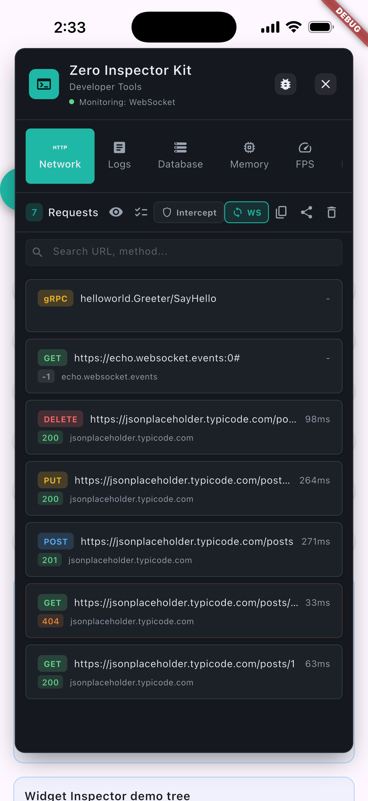
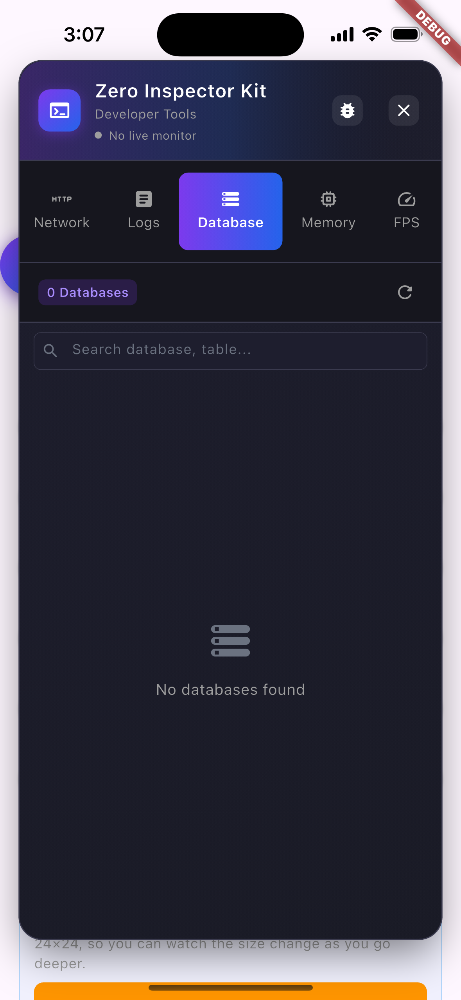
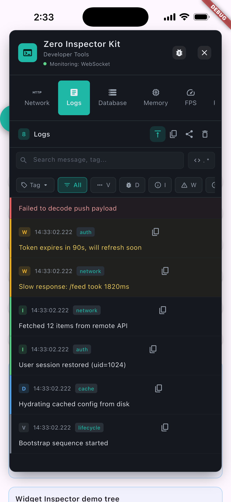
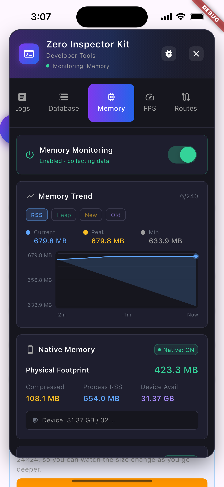
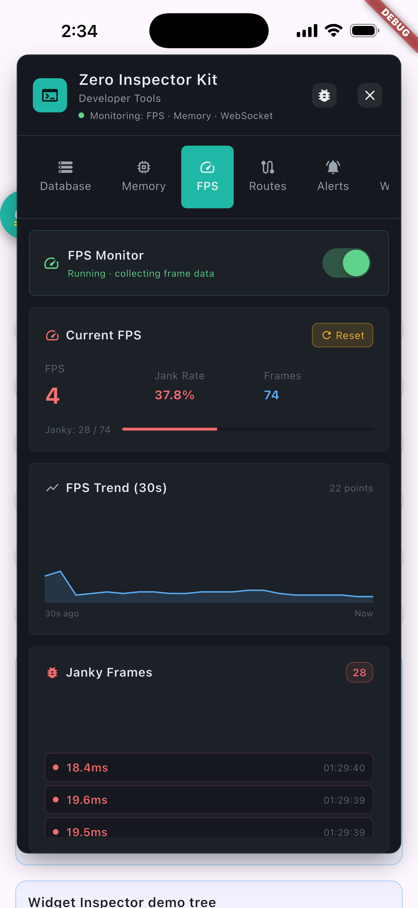
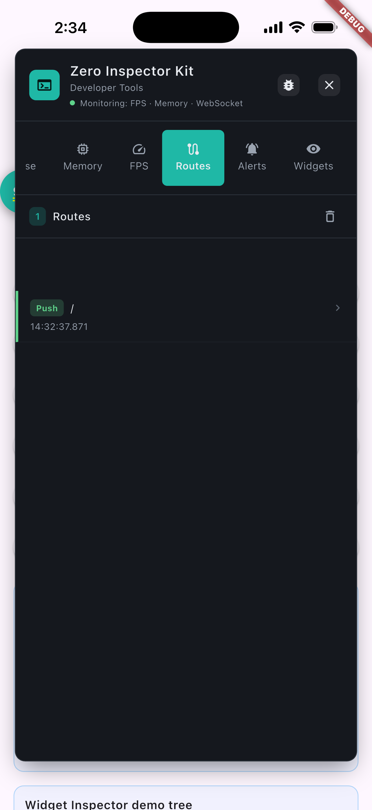
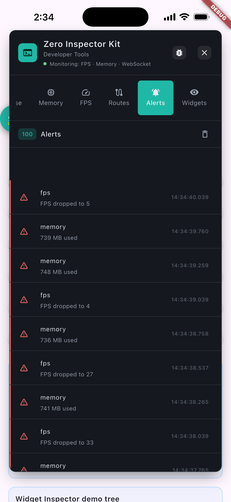
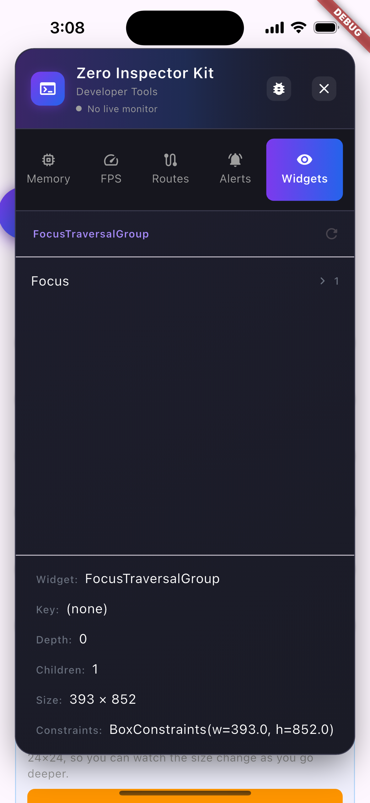

<div align="center">

# Zero Inspector Kit

</div>

<div align="center" style="display: flex; align-items: center; justify-content: center; gap: 36px;">


<span style="font-size: 1.1em; padding: 0 8px;"><a href="README.md">English</a> &nbsp;|&nbsp; <a href="README_zh.md">简体中文</a> &nbsp;|&nbsp; <a href="README_de.md">Deutsch</a> &nbsp;|&nbsp; <strong>Español</strong> &nbsp;|&nbsp; <a href="README_ja.md">日本語</a></span>


</div>

Una consola de desarrollador integrada en la app para Flutter: inspecciona tráfico HTTP, WebSocket y gRPC, supervisa registros, base de datos, fugas de memoria y FPS en tiempo real, rastrea rutas, recibe alertas e informes de errores con un toque — todo sin salir de tu app. Se desactiva automáticamente en compilaciones de release.

[](https://pub.dev/packages/zero_inspector_kit)
[](https://pub.dev/packages/zero_inspector_kit/score)
[](https://github.com/zero-labsco/zero_inspector_kit/actions/workflows/ci.yml)
[](https://github.com/zero-labsco/zero_inspector_kit/blob/main/LICENSE)
[](https://pub.dev/packages/zero_inspector_kit)
[](https://flutter.dev)
[](https://dart.dev)
[](https://pub.dev/packages/effective_dart)

> **🔔 Se recomienda actualizar:** Esta versión añade una opción para incluir el inspector en builds de release (AOT) para QA / pruebas internas — añade `zero_inspector_kit.inspector_modes: all` a tu `pubspec.yaml` (la app que depende de este paquete) y compila con `dart run zero_inspector_kit:build_inspector build apk --release` (recomendado — el asistente lee la configuración de tu `pubspec.yaml`; o pasa `--dart-define=INSPECTOR_MODES=all` directamente si prefieres no usarlo). Los builds de release siguen desactivados y eliminados por tree-shaking por defecto. Nota: las funciones de VM Service (histograma de asignación de memoria, análisis de grafo de objetos) siguen sin estar disponibles en release aunque esté activado — usa un build `--profile` para el análisis completo de memoria. Se recomienda a todos los usuarios actualizar a la última versión (`^2.2.0`).

🌐 **[Sitio web oficial](https://www.zerolabsco.com/)** &nbsp;·&nbsp; 📦 **[Ver en pub.dev](https://pub.dev/packages/zero_inspector_kit)** &nbsp;·&nbsp; 🔗 **[Ver en GitHub](https://github.com/zero-labsco/zero_inspector_kit)**

---

## Tabla de contenidos

- [Características](#características)
- [Capturas de pantalla](#capturas-de-pantalla)
- [Instalación](#instalación)
- [Activar el inspector en builds de release](#activar-el-inspector-en-builds-de-release)
- [Uso](#uso)
  - [Integración Zero-Invasion (Recomendada)](#integración-zero-invasion-recomendada)
  - [No intrusivo por diseño](#no-intrusivo-por-diseño)
  - [Registro (Logging)](#registro-logging)
  - [Monitor de errores](#monitor-de-errores)
  - [Persistencia de sesión](#persistencia-de-sesión)
  - [Solicitudes de red](#solicitudes-de-red)
  - [Captura de WebSocket / gRPC (desactivada por defecto)](#captura-de-websocket--grpc-desactivada-por-defecto)
  - [Interceptador de solicitudes de red](#interceptador-de-solicitudes-de-red)
  - [Proveedor de base de datos](#proveedor-de-base-de-datos)
  - [Monitor de memoria](#monitor-de-memoria)
  - [Monitor de FPS](#monitor-de-fps)
  - [Proveedor de base de datos personalizado](#proveedor-de-base-de-datos-personalizado)
  - [Inspector de Widgets y línea de tiempo de red (activado por defecto)](#inspector-de-widgets-y-línea-de-tiempo-de-red-activado-por-defecto)
- [Referencia de la API](#referencia-de-la-api)
- [Cómo contribuir](#cómo-contribuir)
- [Licencia](#licencia)

---

## Características

- **Integración Zero-Invasion** — Una sola línea de código, sin cambios en el código existente del proyecto.
- **Inspector de red** — Captura en tiempo real de todas las solicitudes HTTP (http y Dio); modifica cuerpos/cabeceras mediante reglas de interceptor; **editor de repetición** integrado (solo edita los parámetros de consulta — la URL/cabeceras/cuerpo permanecen de solo lectura — y previsualiza la respuesta); copia de cURL por lotes; enmascaramiento de cabeceras sensibles; filtrable por método/estado/intercepción.
- **Captura de WebSocket / gRPC** — Captura opcional de protocolos de streaming (desactivada por defecto, conmutada en tiempo de ejecución como Memoria/FPS); los frames de WebSocket y las llamadas gRPC aparecen en la lista de Red.
- **Sistema de registro** — Captura automáticamente `print()`, `debugPrint()` y registros personalizados en múltiples niveles; se integra con bibliotecas de registro de terceros; auto-scroll (pausable), búsqueda por regex, filtrado por etiqueta y copia con un toque de una entrada de registro.
- **Monitor de errores** — Pestaña Errors dedicada (desde v1.9.0): engancha `FlutterError.onError` + `runZonedGuarded`, agrega y elimina duplicados de los fallos por tipo + firma de pila con contador y primera/última vez visto; un distintivo rojo con el contador aparece en el icono de la pestaña Errors; callback `onErrorReport` opcional (desde v1.16.0) reenvía los errores agregados a Sentry / Firebase Crashlytics.
- **Persistencia de sesión** — Los registros / red / errores / **alertas** se vacían de forma asíncrona en la propia base de datos `zero_inspector_kit.db` del inspector (desde v1.9.0; un búfer circular en disco que también aparece en la pestaña Database); al iniciar, los registros, errores y alertas se reproducen en sus pestañas, y las solicitudes de red también pueden reproducirse con `init(enableNetworkReplay: true)` (desde v1.17.0); exporta y comparte el archivo de sesión completo (ahora incluyendo alertas) desde la cabecera del panel.
- **Visor de base de datos** — Inspecciona bases de datos SQLite y otras mediante proveedores personalizados.
- **Monitor de memoria** — Gráfico de tendencia, Dart Heap, desglose de memoria nativa, detección de fugas, estadísticas de caché de imágenes y almacenamiento, y un **histograma de asignación de clases** bajo demanda (VM Service `getAllocationProfile`, lista las clases principales por bytes retenidos con un distintivo "+new" para las clases que han crecido desde el último GC). Todo tras un interruptor maestro para evitar sobrecarga; el análisis profundo de grafo de objetos / rutas de retención queda para las DevTools oficiales. Desde v1.9.0 el detector de fugas también puentea las oficiales `FlutterMemoryAllocations` de Flutter para reducir los falsos positivos.
- **Monitor de FPS** — FPS en tiempo real, detección de jank, gráfico de tendencia, registros de frames con **temporización de fase build + raster** y un **umbral de jank adaptativo** derivado de la frecuencia de refresco de la pantalla (para que las pantallas de 120 Hz sigan siendo estrictas). Interruptor maestro para evitar sobrecarga.
- **Rastreador de rutas** — Historial de navegación y ruta actual (`navigatorObservers: [InspectorRouteObserver()]`).
- **Sistema de alertas** — Alertas basadas en reglas sobre red/logs/memoria/FPS con distintivo de no leídos y limitación; las alertas se persisten en disco y sobreviven a los reinicios de la app.
- **Botón flotante** — Botón de overlay con animación de respiración que se acopla automáticamente a los bordes de la pantalla, evitando conflictos con el gesto de retroceso.
- **Informe de errores con un toque** — Toca el icono de error en la cabecera del panel para compartir una instantánea lista para presentar (modelo de dispositivo + SO + memoria actual + registros recientes + red reciente) mediante el selector de uso compartido del sistema.
- **UI moderna** — Tema oscuro con degradados y colores centralizados y personalizables.
- **Multiplataforma** — Android e iOS.

---

## Capturas de pantalla

> Haz clic en cualquier miniatura para abrir la imagen a tamaño completo.

| Inspector de red | Visor de base de datos |
| --- | --- |
| <a href="https://raw.githubusercontent.com/zero-labsco/zero_inspector_kit/main/image/screenshot/network.png"></a> | <a href="https://raw.githubusercontent.com/zero-labsco/zero_inspector_kit/main/image/screenshot/database.png"></a> |

| Registro | Monitor de memoria |
| --- | --- |
| <a href="https://raw.githubusercontent.com/zero-labsco/zero_inspector_kit/main/image/screenshot/logs.png"></a> | <a href="https://raw.githubusercontent.com/zero-labsco/zero_inspector_kit/main/image/screenshot/memory.png"></a> |

| Monitor de FPS | Rastreador de rutas |
| --- | --- |
| <a href="https://raw.githubusercontent.com/zero-labsco/zero_inspector_kit/main/image/screenshot/fps.png"></a> | <a href="https://raw.githubusercontent.com/zero-labsco/zero_inspector_kit/main/image/screenshot/routes.png"></a> |

| Alertas | Inspector de Widgets |
| --- | --- |
| <a href="https://raw.githubusercontent.com/zero-labsco/zero_inspector_kit/main/image/screenshot/alerts.png"></a> | <a href="https://raw.githubusercontent.com/zero-labsco/zero_inspector_kit/main/image/screenshot/widgets.png"></a> |

---

## Instalación

### Pub.dev (Recomendado)

```yaml
dependencies:
  zero_inspector_kit: ^2.2.0
```

### GitHub

```yaml
dependencies:
  zero_inspector_kit:
    git:
      url: https://github.com/zero-labsco/zero_inspector_kit.git
      ref: release/v2.2.0   # reemplaza 2.2.0 con la versión que necesites
```

### OpenHarmony

> El puerto nativo de OpenHarmony (plugin ArkTS) vive en la rama `ohos/vX.Y.Z` — `main` no lo incluye. Para usar el inspector en OpenHarmony, instálalo desde esa rama:

```yaml
dependencies:
  zero_inspector_kit:
    git:
      url: https://github.com/zero-labsco/zero_inspector_kit.git
      ref: ohos/v2.2.0   # reemplaza 2.2.0 con la versión que necesites
```

Requiere el SDK de OpenHarmony Flutter y DevEco Studio; el módulo nativo `ohos/` incluido debe compilarse como parte de tu app OHOS.

---

## Activar el inspector en builds de release

Por defecto el inspector está **desactivado automáticamente y eliminado por tree-shaking en los builds de release (AOT)** — su código no está en el binario final, por lo que no se puede activar en tiempo de ejecución. Para publicar un build de release que siga incluyendo el inspector para QA / pruebas internas, hay que optar por ello en **tiempo de compilación**.

Si no añades la clave `zero_inspector_kit:` a tu pubspec, se usa `debug` por defecto — los builds de release siguen eliminados por tree-shaking, igual que antes.

Añade la configuración opcional a **tu `pubspec.yaml`** (la app que depende de este paquete):

```yaml
zero_inspector_kit:
  inspector_modes: all   # el valor por defecto es `debug`
```

La forma recomendada es mantener la configuración en `pubspec.yaml` y compilar con el helper (lee `inspector_modes` e inyecta el flag por ti):

```bash
# en el directorio de tu app
dart run zero_inspector_kit:build_inspector build apk --release
# o pasa el flag directamente:
flutter build apk --release --dart-define=INSPECTOR_MODES=all
```

- `debug` (por defecto): activo en debug/profile, desactivado (tree-shaken) en release.
- `all`: también incluido y activo en builds de release.

> **⚠️ Qué NO funciona en un build de release aunque esté activado**
> Un build de release (AOT) desactiva el Dart VM Service, por lo que todo lo que depende de él no está disponible, sea cual sea este flag:
> - **Histograma de asignación** de memoria (VM Service `getAllocationProfile`)
> - Análisis profundo de grafo de objetos / caminos de retención
> - Cualquier introspección en vivo del VM Service
>
> Lo que sí funciona en release: **inspección HTTP / WebSocket / gRPC, logs, agregación de errores, seguimiento de FPS/jank, rutas y el exportador de informes de bug.** Si los testers necesitan el análisis completo de memoria, dales un build **`--profile`** — mantiene el VM Service accesible y se comporta como release.

---

## Uso

### Integración Zero-Invasion (Recomendada)

Integra con solo **1 línea de código**, sin necesidad de modificar ningún código existente del proyecto:

```dart
import 'package:flutter/material.dart';
import 'package:zero_inspector_kit/zero_inspector_kit.dart';

void main() {
  // Una línea: inicializa el inspector, captura print() vía Zone, muestra el botón flotante
  ZeroInspectorKit.runAppWithInspector(const MyApp());
}

class MyApp extends StatelessWidget {
  const MyApp({super.key});

  @override
  Widget build(BuildContext context) {
    return MaterialApp(
      navigatorObservers: [InspectorRouteObserver()],
      home: Scaffold(
        appBar: AppBar(title: const Text('App')),
        body: const Center(child: Text('Hello World')),
      ),
    );
  }
}
```

**Lo que el inspector hace automáticamente (sin otros cambios de código):**

| Capacidad | Cómo |
|------------|-----|
| ✅ Captura de registros | Todas las llamadas `print()` / `debugPrint()` y errores de Flutter vía Zone |
| ✅ Intercepción de red | Todas las solicitudes **http** y **Dio** vía `HttpOverrides` (Dio usa `HttpClient`) |
| ✅ Escaneo de base de datos | Escanea y registra automáticamente las bases de datos SQLite |
| ✅ Botón flotante | Mostrado vía `Overlay`, sin necesidad de widget manual |
| ✅ Seguimiento de rutas | Vía `InspectorRouteObserver` (se inyecta automáticamente en `MaterialApp`) |

**Compilación de producción:** El inspector se desactiva automáticamente en compilaciones de release — el tree-shaking elimina todo el código relacionado, por lo que nunca necesitas borrar nada.

> **¿Prefieres sin Zone global?** La línea de arriba envuelve `runApp` en una `Zone` *solo* para capturar las llamadas `print()` sin procesar. Si tu equipo desconfía de cualquier Zone global, quítala por completo — la captura de `debugPrint()` y todas las demás capacidades siguen activas:
>
> ```dart
> void main() {
>   // Nunca se introduce una Zone global; solo la captura de debugPrint sigue activa.
>   ZeroInspectorKit.runAppWithInspector(
>     const MyApp(),
>     enablePrintZoneCapture: false,
>   );
> }
> ```

### No intrusivo por diseño

Sabemos que los desarrolladores recelan con razón de las bibliotecas de terceros que secuestran el estado global. `zero_inspector_kit` se construyó para no interponerse en tu camino:

- **`HttpOverrides` se *encadena*, no se reemplaza.** El plugin se envuelve sobre cualquier `HttpOverrides` que tu app ya use (proxy / certificate-pinning / `createHttpClient` personalizado) y reenvía cada llamada al original. Tu lógica de reintentos, ajustes de proxy e interceptores siguen funcionando sin tocarse — el inspector solo *lee* una copia del tráfico.
- **El `HttpClient` capturado es un proxy transparente.** `authenticate`, `findProxy`, `connectionFactory`, `badCertificateCallback`, `maxConnectionsPerHost` y compañía se delegan todos a tu cliente real. Nada del ciclo de vida de la solicitud se altera.
- **La `Zone` es superficial y opcional.** Solo existe para capturar `print()` sin procesar; degrada elegantemente a no-op si el binding de Flutter ya está inicializado, y puedes eliminarla por completo con `enablePrintZoneCapture: false`.
- **Todo es reversible vía `dispose()`.** `dispose()` restaura tu `FlutterError.onError` original, restaura el `HttpOverrides` anterior, detiene todos los temporizadores y la supervisión, y desmonta el overlay — para que puedas desactivar la recolección en tiempo de ejecución (p. ej. un conmutador de privacidad "dejar de recoger") y volver a `init()` más tarde.
- **Seguro en release.** Todo el código de recolección se elimina por tree-shaking en compilaciones de release, por lo que nunca puede afectar al comportamiento de producción ni al tamaño del binario.

Esto es un *complemento* a Flutter DevTools, no un competidor: usa la consola integrada para una triage rápida en dispositivo durante el desarrollo y la revisión, y recurre al profiler de CPU y Heap Snapshot profundo de DevTools cuando necesites análisis autoritativo y sin conexión.

### Integración manual (más control)

```dart
import 'package:shared_preferences/shared_preferences.dart';
import 'package:hive/hive.dart';

void main() async {
  // 1) Init manual (más control que el ayudante de una línea)
  ZeroInspectorKit.init(
    enableWidgetInspector: true,   // opcional: pre-activar el Inspector de Widgets
    enableNetworkTimeline: true,   // opcional: pre-activar la línea de tiempo de red
  );

  // 2) Registrar fuentes de datos personalizadas (API de una línea)
  final prefs = await SharedPreferences.getInstance();
  ZeroInspectorKit.registerSharedPrefs(SharedPreferencesAdapter(prefs));

  final settings = await Hive.openBox('settings');
  final cache = await Hive.openBox('cache');
  ZeroInspectorKit.registerHive({
    'settings': HiveBoxAdapter(settings),
    'cache': HiveBoxAdapter(cache),
  });

  // 3) Envuelve tu app
  runApp(ZeroInspectorKit.wrapApp(const MyApp()));
}
```

> **Sobre las dependencias:** el plugin en sí no necesita `shared_preferences` / `hive`; **tu app** debe añadirlos a su propio `pubspec.yaml` si quiere inspeccionarlos. Ambos aparecen en la pestaña **Database** y reutilizan el mismo flujo de navegación/exportación que SQLite.

<details>
<summary>¿Prefieres la API cruda? Registra los proveedores tú mismo.</summary>

```dart
import 'package:zero_inspector_kit/zero_inspector_kit.dart';

void main() {
  ZeroInspectorKit.init();
  DatabaseRegistry.instance.registerProvider(SharedPrefsProvider(prefs: prefs));
  DatabaseRegistry.instance.registerProvider(HiveProvider(box: box, name: 'settings'));
  runApp(ZeroInspectorKit.wrapApp(const MyApp()));
}
```

</details>

### Registro (Logging)

Inicia la captura automática desde múltiples fuentes:

```dart
InspectorLogInterceptor.instance.start();
```

**Capturado automáticamente:** `print()` / `debugPrint()`, errores del framework de Flutter (hook de `FlutterError.onError`) y excepciones de `runZonedGuarded`.

> Desde v1.9.0, esos errores también se agregan y eliminan duplicados en la pestaña dedicada **Errors** (ver abajo) — el flujo de registro los mantiene como líneas de nivel error, mientras que Errors responde "¿se repite el mismo fallo?".

**Registro manual (opcional):**

```dart
InspectorLog.v('Verbose'); InspectorLog.d('Debug');
InspectorLog.i('Info');    InspectorLog.w('Warning');
InspectorLog.e('Error');
```

Las bibliotecas de terceros que registran vía `print()`/`debugPrint()` (p. ej. `logger`, `flutter_logger`) se capturan automáticamente — sin configuración. Usa `onLogCaptured` para sincronizar los registros capturados de vuelta a tu propio servicio de registro:

```dart
import 'package:logger/logger.dart';
final logger = Logger();

InspectorLogInterceptor.instance.onLogCaptured = (entry) {
  logger.log(_mapLogLevel(entry.level),
    '${entry.tag != null ? '[${entry.tag}] ' : ''}${entry.message}');
};
```

### Monitor de errores

> Disponible desde v1.9.0

La pestaña **Errors** responde "¿se repite el mismo fallo?". `ErrorService` engancha `FlutterError.onError` y `PlatformDispatcher.onError` (ambos con save/restore, manteniendo el comportamiento original de pantalla roja) más `runZonedGuarded` dentro de `runAppWithInspector()`, y agrega cada excepción por **tipo + firma de pila**: los fallos repetidos se fusionan en un registro con un contador **×N** y primera/última vez visto. Toca una fila para expandir la muestra de pila completa, filtra por búsqueda y copia pilas individuales. Un distintivo rojo con el contador en el icono de la pestaña Errors muestra el número de registros agregados mientras el panel está abierto.

```dart
import 'package:zero_inspector_kit/zero_inspector_kit.dart';

// Reporte manual — gRPC / protocolo personalizado / tus propias rutas de error
ErrorService.instance.report(error, stackTrace, 'myModule');

// Leer registros agregados (más recientes primero)
final ErrorRecord latest = ErrorService.instance.errors.first;

// Borrar todos los registros
ErrorService.instance.clear();
```

Reenvía cada error agregado — incluidos los aciertos repetidos — a un reportero de terceros como Sentry o Firebase Crashlytics con el callback `onErrorReport`:

```dart
ZeroInspectorKit.init(
  onErrorReport: (ErrorRecord record) {
    // record lleva type, message, signature, count y first/last seen
    Crashlytics.recordError(
      record.message,
      record.sampleStack,
      reason: '${record.type} x${record.count}',
    );
  },
);
```

El callback se dispara una vez por ocurrencia (por lo que un fallo recurrente se reporta cada vez con un contador `×N` actualizado); los registros restaurados desde disco al iniciar **no** se vuelven a reportar. Un callback que lanza excepciones nunca rompe el inspector — los fallos solo se registran internamente.

Conmuta con `enableErrorCapture` en `init()` (por defecto `true`). Detalles completos en la [página Errors](website/pages/Errors.md).

### Persistencia de sesión

> Disponible desde v1.9.0

Los registros, solicitudes de red, errores agregados y **alertas** se vacían de forma asíncrona en el propio archivo de base de datos del inspector, **`zero_inspector_kit.db`** — un búfer circular en disco respaldado por SQLite que también aparece en la pestaña **Database**. En el siguiente inicio, **los registros, errores agregados y alertas se reproducen en sus pestañas**; las solicitudes de red permanecen archivadas en disco para exportarlas más tarde, o también se reproducen en la pestaña Network con `init(enableNetworkReplay: true)` (desde v1.17.0). Por tanto, los datos sobreviven a los reinicios de la app aunque nunca hayas abierto el panel. Toca el **icono de almacenamiento** en la cabecera del panel para abrir el gestor de **Persisted data**: ve el número de filas por categoría, exporta el **archivo de sesión completo** (ahora incluyendo una sección `alerts`) como JSON (selector de uso compartido), o vacía el disco.

```dart
// Leer datos persistidos mediante programación (opcional)
final logs   = await PersistenceService.instance.loadLogs();
final errors = await PersistenceService.instance.loadErrors();

// Instantánea de sesión completa, p. ej. adjuntar a un informe de error
final String archive = await PersistenceService.instance.buildSessionArchiveJson();

// Exportar y compartir vía el selector de uso compartido del sistema
await PersistenceService.instance.exportSessionArchiveAndShare();

// Borrar el búfer circular en disco
await PersistenceService.instance.clearAll();
```

Conmuta con `enablePersistence` en `init()` (por defecto `true`). Pon tanto `enableErrorCapture` como `enablePersistence` a `false` para mantener todo solo en memoria.

### Solicitudes de red

Todas las solicitudes HTTP (tanto **http** como **Dio**) se interceptan automáticamente vía `HttpOverrides` tras la init — no se requiere configuración.

```dart
import 'package:http/http.dart' as http;
final r = await http.get(Uri.parse('https://api.example.com/data')); // capturada
```

```dart
import 'package:dio/dio.dart';
final dio = Dio();
final r = await dio.get('https://api.example.com/data'); // capturada
```

> **Nota:** Dio usa `IOHttpClientAdapter` (que usa el `HttpClient` de `dart:io`), por lo que se captura automáticamente sin configuración adicional.

### Captura de WebSocket / gRPC (desactivada por defecto)

WebSocket, gRPC y otros protocolos de streaming se capturan de forma **opt-in** — desactivada por defecto y conmutable en tiempo de ejecución como los monitores de Memoria/FPS, para que las apps que no los usan no paguen nada.

**WebSocket:** reemplaza `WebSocket.connect` por `InspectorWebSocket.connect`. Activa la captura primero tocando el conmutador `WS` en la pestaña Network.

```dart
import 'dart:io';
import 'package:zero_inspector_kit/zero_inspector_kit.dart';

final ws = await InspectorWebSocket.connect('wss://example.com/socket');
ws.listen((message) {
  // los frames entrantes se capturan automáticamente mientras la captura está activa
});
ws.add('ping'); // los frames salientes también se capturan automáticamente
```

Los frames capturados aparecen en la lista **Network** (método `WS`), reutilizando la vista de línea de tiempo y detalle. Cuando la captura está desactivada, `InspectorWebSocket.connect` se comporta exactamente como `WebSocket.connect` sin sobrecarga.

**gRPC / web_socket_channel / otras pilas:** estas no pueden interceptarse de forma transparente por `dart:io`, así que usa el hook manual:

```dart
WsInspectorService.instance.recordCall(
  name: 'UserService/GetUser',
  request: requestJson,
  response: responseJson,
);
```

### Interceptador de solicitudes de red

Modifica solicitudes mediante reglas — útil para probar parámetros sin tocar el código de la app.

**Flujo de trabajo:** envía una solicitud → abre el detalle → toca el icono de interceptor → configura la regla (patrón de URL, método, ediciones de cuerpo/cabecera) → guarda. Las siguientes solicitudes coincidentes usan los parámetros modificados.

| Aspecto | Detalle |
|--------|--------|
| Ediciones soportadas | Cuerpo y cabeceras de la solicitud (solo POST/PUT/PATCH) |
| Solicitudes GET | Solo lectura, no se pueden modificar (sin cuerpo) |
| Coincidencia de reglas | Patrón de URL exacto o regex; filtro de método (GET/POST/PUT/DELETE/PATCH/HEAD/Any) |

Cuando no hay reglas configuradas o están desactivadas, todas las solicitudes se envían sin modificar.

### Proveedor de base de datos

```dart
DatabaseRegistry.instance.registerProvider(SqliteDatabaseProvider());
```

### Monitor de memoria

Análisis exhaustivo con un interruptor maestro (desactivado por defecto para evitar sobrecarga).

- **Interruptor maestro:** conmutador superior en el panel de Memory; desactivado = sin temporizadores / sin conexión al VM Service.
- **Gráfico de tendencia:** ventana de 2 minutos (240 instantáneas × 500 ms), conmutable entre Process RSS / Dart Heap / New Space / Old Space.
- **Dart Heap (necesita VM Service):** barras de uso/capacidad/externo; desglose new/old-space; disparador de GC manual.
- **Memoria nativa (dispositivos reales):** desglose de Android PSS; footprint físico/comprimido/RSS de iOS; advertencia de memoria baja.
- **Detección de fugas (Dart 2.17+ `WeakReference`):** flujo de cuatro estados de `trackObject()`; verificación automática de GC; la UI muestra objetos sospechosos/seguimiento/liberados. Desde v1.9.0 también puentea las oficiales `FlutterMemoryAllocations` de Flutter (activadas vía `enableFlutterLeakTracker`) para que los objetos ya reportados como `disposed` se traten como liberados — reduciendo los falsos positivos.

```dart
myBloc.trackMemoryLeak(tag: 'HomePage_myBloc');   // forma abreviada
// o: trackMemoryLeak(myBloc, tag: 'HomePage_myBloc');
myBloc.untrackMemoryLeak();                        // cancelar
MemoryInspectorService.instance.clearLeakRecords(); // borrar todo
```

- **Caché de imágenes:** tamaño/cantidad en vivo, pendiente vs. vivo, barra de uso, borrado con un toque.
- **Almacenamiento de la app:** tamaño de documents / temp / DB, borrado de temp con un toque.

> **⚠️ Disponibilidad del VM Service:** al depurar vía `flutter run` en PC, el Dart VM Heap puede mostrar `VM: OFF` (peculiaridad de reenvío de puertos). La memoria nativa y el Process RSS siguen funcionando. Abrir la app de depuración directamente en el dispositivo muestra los datos del Heap correctamente.

### Monitor de FPS

Análisis de frames en tiempo real con un interruptor maestro (desactivado por defecto).

- **Interruptor maestro:** conmutador superior; desactivado = sin callback de timings, cero sobrecarga.
- **Métricas:** FPS actual, tasa de jank, frames totales, gráfico de tendencia de 30 segundos (60 puntos), lista de frames janky con **división build + raster** (cada frame janky muestra su duración build vs raster para que veas qué fase se bloqueó).
- **Precisión (desde v1.2.1):** usa marcas de tiempo reales de `buildStart` (no `DateTime.now()`) y duración `rasterFinish - buildStart`, capturando el jank de raster de GPU.
- **Umbral adaptativo:** el corte de jank se deriva de la frecuencia de refresco de la pantalla (`1000ms / refreshRate`), por lo que 60 Hz ≈ 16,7 ms mientras que una pantalla de 120 Hz usa una barrera ajustada de ≈ 8,3 ms en lugar de dejarse pasar por los 16 ms fijos.

```dart
FpsService.instance.start();
final fps = FpsService.instance.currentFps;
final jank = FpsService.instance.jankRate;
FpsService.instance.clear();
```

### Proveedor de base de datos personalizado

Implementa `DatabaseProvider` para otras bases de datos:

```dart
class MyCustomDatabaseProvider implements DatabaseProvider {
  @override
  String get name => 'CustomDB';

  @override
  Future<List<DatabaseInfo>> getDatabases() async => [];

  @override
  Future<QueryResult> queryTable(String dbPath, String tableName, {int limit = 50}) async =>
      QueryResult(columns: [], rows: []);
}

DatabaseRegistry.instance.registerProvider(MyCustomDatabaseProvider());
```

### Inspector de Widgets y línea de tiempo de red (activado por defecto)

Ambos están **activados por defecto**. Puedes desactivarlos mediante el conmutador del panel si no los necesitas. Pre-actívalos al inicio:

```dart
ZeroInspectorKit.runAppWithInspector(
  const MyApp(),
  enableWidgetInspector: true,   // snapshot único del árbol + navegación por migas de pan
  enableNetworkTimeline: true,   // cascada de solicitudes en vivo
);
```

- **Inspector de Widgets:** snapshot único explorado mediante navegación por migas de pan (no en vivo; toca Refresh para volver a capturar).
- **Línea de tiempo de red:** cascada en vivo de solicitudes, sin actualización manual.

### Informe de errores

Toca el **icono de error** en la cabecera del panel para generar y compartir un informe de errores con un toque — ideal para que QA adjunte contexto de entorno al presentar incidencias.

La instantánea de texto compartida incluye:

- **Dispositivo:** modelo real (p. ej. `Pixel 8 Pro` / `iPhone (iPhone16,1)`), SO y versión, locale, runtime de Dart, núcleos de CPU.
- **Memoria:** uso actual del heap y si se admite memoria nativa.
- **Registros recientes:** las últimas entradas de registro capturadas.
- **Red reciente:** las últimas solicitudes capturadas.

Las cabeceras sensibles se enmascaran igual que en la pestaña Network (conmuta "Sensitive hidden" en el panel). Ningún dato sale del dispositivo salvo a través del destino de uso compartido que elijas (correo, IM, etc.).

> No requiere configuración adicional — funciona en cuanto el inspector está en ejecución.

---

## Referencia de la API

### ZeroInspectorKit

La clase de entrada de nivel superior. Llama a `init()` (o `runAppWithInspector()`) una vez para iniciar la recolección; llama a `dispose()` para liberar completamente los recursos de proceso completo del inspector (temporizador de vaciado de persistencia, hooks de `FlutterError.onError` / `PlatformDispatcher.onError`, temporizadores de memoria / FPS, notificadores de limitación y persistencia en disco) para que la recolección pueda desactivarse por completo en tiempo de ejecución — p. ej. tras un conmutador de cumplimiento de privacidad — y reactivarse más tarde vía `init()`.

```dart
// Detener completamente la recolección (libera cada recurso de proceso completo).
ZeroInspectorKit.instance.dispose();

// Reactivar más tarde con las mismas u otras opciones.
ZeroInspectorKit.instance.init();
```

### FloatingInspectorButton

| Parámetro | Tipo | Descripción |
|-----------|------|-------------|
| `enabled` | `bool` | Si el inspector está activado (por defecto: `true`, se desactiva automáticamente en release) |

### ConditionalInspector

Muestra/oculta automáticamente el inspector según el modo de compilación.

```dart
ConditionalInspector(child: YourAppWidget())
```

| Parámetro | Tipo | Descripción |
|-----------|------|-------------|
| `child` | `Widget` | El widget hijo |
| `enabled` | `bool` | Si el inspector está activado (por defecto: `true`) |

### InspectorLogInterceptor

| Método | Descripción |
|--------|-------------|
| `start()` / `stop()` | Iniciar / detener la captura de registros |
| `log(level, message, tag)` | Añadir una entrada de registro |
| `verbose/debug/info/warning/error(message, tag)` | Añadir un registro en el nivel dado |

| Propiedad | Tipo | Descripción |
|----------|------|-------------|
| `onLogCaptured` | `void Function(LogEntry)?` | Callback para integración de registro de terceros |

### InspectorLog

Forma abreviada de `InspectorLogInterceptor.instance`.

| Método | Descripción |
|--------|-------------|
| `start()` / `stop()` | Iniciar / detener la captura de registros |
| `log(level, message, {tag})` | Añadir una entrada de registro |
| `v/d/i/w/e(message, {tag})` | Añadir un registro en el nivel dado |

| Propiedad | Tipo | Descripción |
|----------|------|-------------|
| `isRunning` | `bool` | Si la captura de registros está activa |

### InspectorRouteObserver

Observador del navigator para rastrear cambios de ruta.

### FpsService

Servicio FPS singleton que extiende `ChangeNotifier`.

| Método | Descripción |
|--------|-------------|
| `start()` / `stop()` | Iniciar / detener la supervisión |
| `clear()` | Borrar todo el historial y los contadores |

| Propiedad | Tipo | Descripción |
|----------|------|-------------|
| `isRunning` | `bool` | Si la supervisión está activa |
| `currentFps` | `double` | FPS actual (cada 500 ms) |
| `jankRate` | `double` | Tasa de jank (%) |
| `totalFrameCount` | `int` | Número total de frames capturados |
| `totalJankyCount` | `int` | Número total de frames janky (>16 ms) |
| `lastFrameJanky` | `bool` | Si el último frame fue janky |
| `fpsHistory` | `List<double>` | Últimos 60 valores de FPS (inmodificable) |
| `frameRecords` | `List<FrameRecord>` | Registros de frames recientes (inmodificable, ≤3600) |

### runInspectorApp

Ejecuta tu app dentro de la Zone del inspector para la captura automática de `print()`.

```dart
runInspectorApp(VoidCallback appRunner)
```

| Parámetro | Tipo | Descripción |
|-----------|------|-------------|
| `appRunner` | `VoidCallback` | Función para ejecutar tu app (normalmente `runApp`) |

---

## Cómo contribuir

¡Las contribuciones son bienvenidas! Por favor lee las [Directrices de contribución](CONTRIBUTING.md) antes de enviar incidencias o pull requests.

- 🐛 [Reportar un error](https://github.com/zero-labsco/zero_inspector_kit/issues/new?template=bug_report.md)
- 💡 [Solicitar una función](https://github.com/zero-labsco/zero_inspector_kit/issues/new?template=feature_request.md)
- 💬 [Unirse a las discusiones](https://github.com/zero-labsco/zero_inspector_kit/discussions)
- 📖 [Guía de contribución](CONTRIBUTING.md)

---

## Licencia

Copyright (c) 2026 Zero Labs Co. (AmisKwok). Este proyecto se publica bajo la **Mozilla Public License 2.0 (MPL-2.0)** — consulta el archivo [LICENSE](LICENSE) para más detalles. El aviso de copyright y las declaraciones adicionales (sin garantía, sin respaldo) están en [NOTICE](NOTICE).

- **Uso comercial permitido.** Se permite el uso, la modificación y la distribución sin código abierto.
- **¿Modificaste el plugin?** Los archivos que modifiques deben publicarse en forma de código fuente bajo MPL-2.0. Tu propia app **no** necesita ser de código abierto.
- **¿Lo usaste sin modificar?** No se requiere divulgación del código fuente.
- **Sin respaldo.** "Zero Labs Co.", "zero_inspector_kit", el logo / arte de la mascota y el nombre del autor (AmisKwok) no pueden usarse para respaldar o promocionar productos derivados, ni para implicar patrocinio o afiliación, sin permiso escrito previo.
- **Sin garantía, sin responsabilidad.** El titular del copyright no ofrece ninguna garantía y no acepta responsabilidad por ninguna versión modificada o derivada; las versiones modificadas deben marcarse claramente como modificadas.

Este plugin se proporciona "tal cual", sin garantía de ningún tipo. El autor no asume ninguna responsabilidad por la funcionalidad, la seguridad o cualquier consecuencia derivada del uso de versiones modificadas o proyectos derivados.
