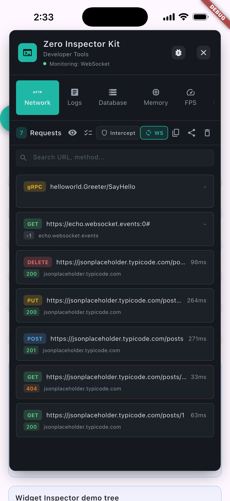
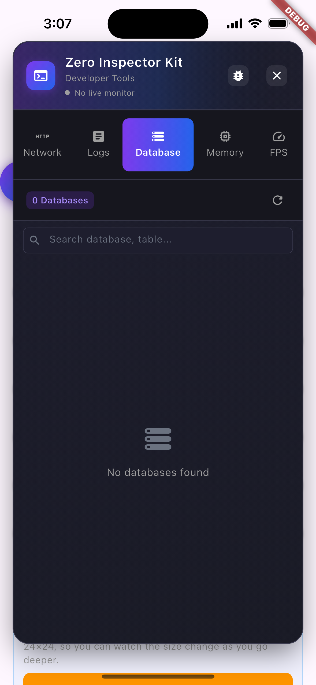
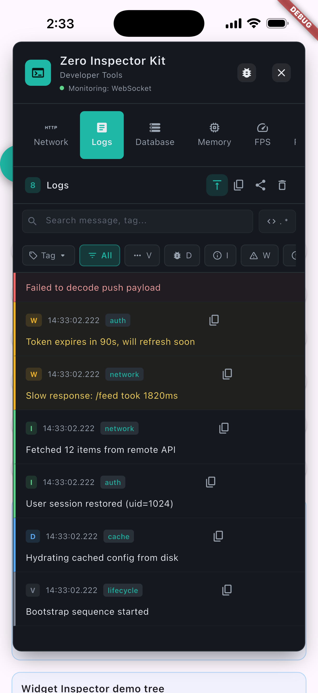
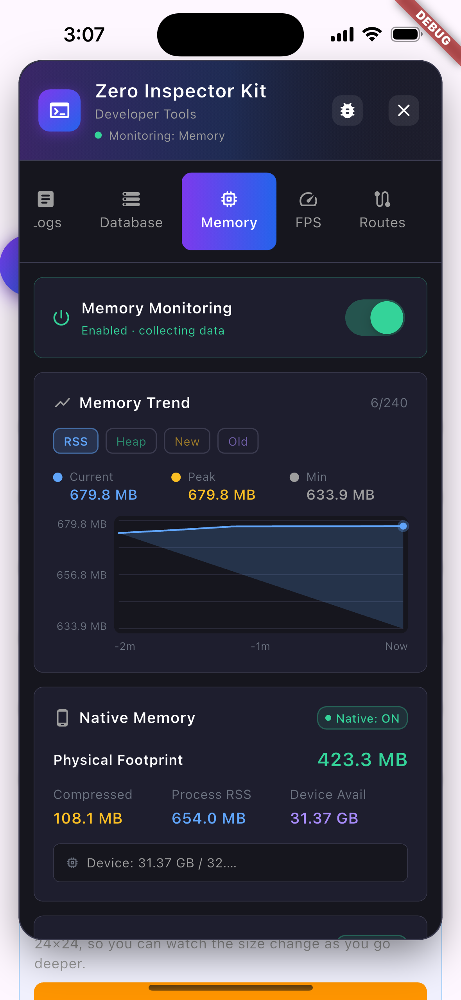
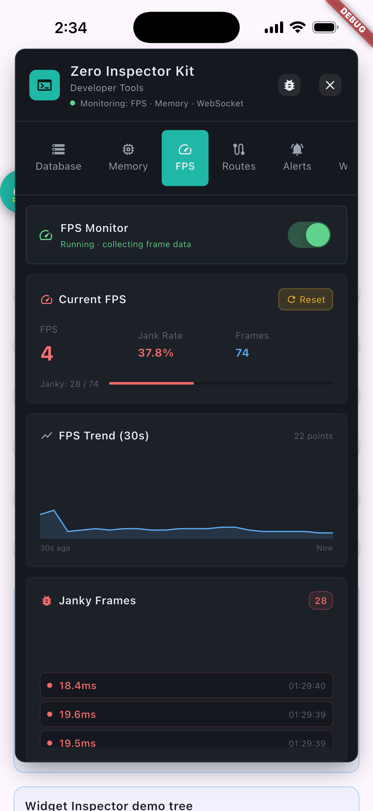
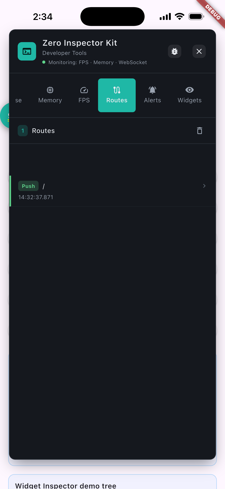
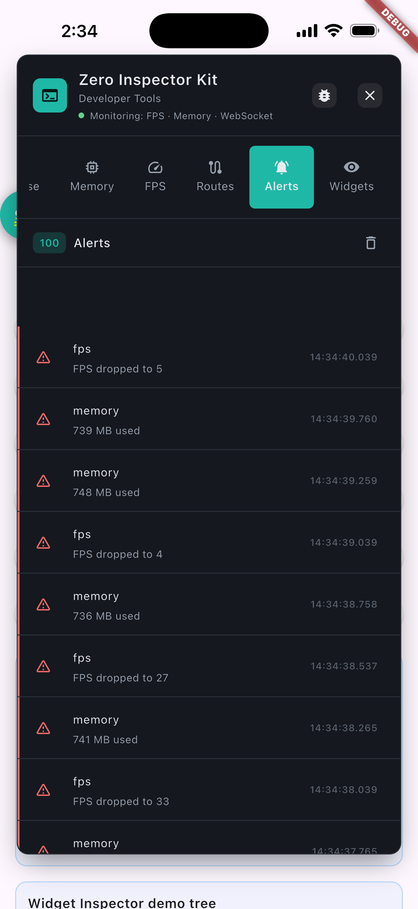
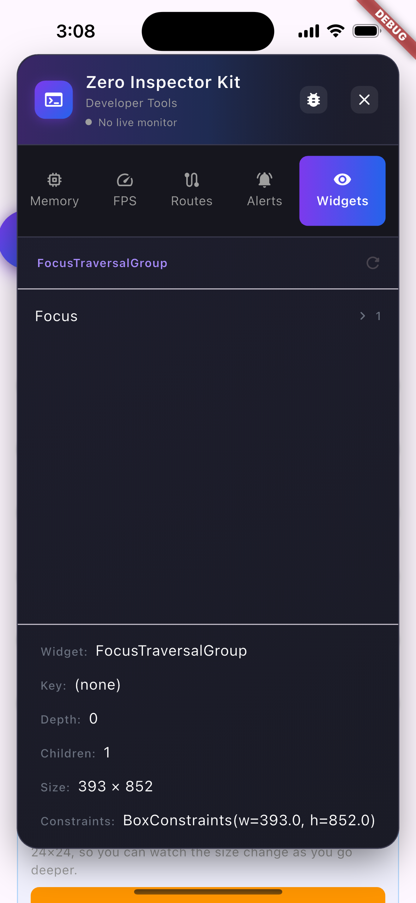

<div align="center">

# Zero Inspector Kit

</div>

<div align="center" style="display: flex; align-items: center; justify-content: center; gap: 36px;">


<span style="font-size: 1.1em; padding: 0 8px;"><a href="README.md">English</a> &nbsp;|&nbsp; <a href="README_zh.md">简体中文</a> &nbsp;|&nbsp; <a href="README_de.md">Deutsch</a> &nbsp;|&nbsp; <a href="README_es.md">Español</a> &nbsp;|&nbsp; <strong>日本語</strong></span>


</div>

Flutter 向けのアプリ内開発者コンソールです。HTTP・WebSocket・gRPC の通信を検査し、ログ・データベース・メモリリーク・FPS をリアルタイムで監視し、ルートを追跡し、アラートやワンタップのバグ報告を提供します——アプリを離れることなくすべてが行えます。リリースビルドでは自動的に無効化されます。

[](https://pub.dev/packages/zero_inspector_kit)
[](https://pub.dev/packages/zero_inspector_kit/score)
[](https://github.com/zero-labsco/zero_inspector_kit/actions/workflows/ci.yml)
[](https://github.com/zero-labsco/zero_inspector_kit/blob/main/LICENSE)
[](https://pub.dev/packages/zero_inspector_kit)
[](https://flutter.dev)
[](https://dart.dev)
[](https://pub.dev/packages/effective_dart)

> **🔔 アップグレードを推奨：** このリリースでは、QA／社内テスト向けにインスペクターを release（AOT）ビルドに同梱するオプションを追加しました——あなたのアプリの `pubspec.yaml`（このパッケージに依存するアプリ）に `zero_inspector_kit.inspector_modes: all` を追加し、`dart run zero_inspector_kit:build_inspector build apk --release`（このヘルパーはパッケージに同梱されます。あるいは `--dart-define=INSPECTOR_MODES=all` を直接指定しても可）でビルドします。release ビルドはデフォルトで無効かつ tree-shake により除外されたままです。注意：VM Service 系の機能（メモリ割り当てヒストグラム、オブジェクトグラフ解析）は、たとえ有効にしても release では引き続き利用できません——完全なメモリ解析には `--profile` ビルドを使用してください。すべてのユーザーに最新バージョン（`^2.2.0`）へのアップグレードをお勧めします。

🌐 **[公式ウェブサイト](https://www.zerolabsco.com/)** &nbsp;·&nbsp; 📦 **[pub.dev で見る](https://pub.dev/packages/zero_inspector_kit)** &nbsp;·&nbsp; 🔗 **[GitHub で見る](https://github.com/zero-labsco/zero_inspector_kit)**

---

## 目次

- [機能](#機能)
- [スクリーンショット](#スクリーンショット)
- [インストール](#インストール)
- [release ビルドでのインスペクター有効化](#release-ビルドでのインスペクター有効化)
- [使い方](#使い方)
  - [ゼロ侵略的統合（推奨）](#ゼロ侵略的統合推奨)
  - [設計上非侵襲](#設計上非侵襲)
  - [ログ記録](#ログ記録)
  - [エラー監視](#エラー監視)
  - [セッションの永続化](#セッションの永続化)
  - [ネットワークリクエスト](#ネットワークリクエスト)
  - [WebSocket / gRPC のキャプチャ（デフォルト無効）](#websocket--grpc-のキャプチャデフォルト無効)
  - [ネットワークリクエストのインターセプター](#ネットワークリクエストのインターセプター)
  - [データベースプロバイダー](#データベースプロバイダー)
  - [メモリ監視](#メモリ監視)
  - [FPS 監視](#fps-監視)
  - [カスタムデータベースプロバイダー](#カスタムデータベースプロバイダー)
  - [ウィジェットインスペクターとネットワークタイムライン（デフォルト有効）](#ウィジェットインスペクターとネットワークタイムラインデフォルト有効)
- [API リファレンス](#api-リファレンス)
- [コントリビュート](#コントリビュート)
- [ライセンス](#ライセンス)

---

## 機能

- **ゼロ侵略的統合** — 1 行のコードで、既存のプロジェクトコードを変更する必要はありません。
- **ネットワークインスペクター** — すべての HTTP（http と Dio）リクエストをリアルタイムでキャプチャ；インターセプトルールでボディ／ヘッダーを変更；アプリ内**リプレイエディター**（クエリパラメーターのみ編集可能——URL／ヘッダー／ボディは読み取り専用のまま——レスポンスをプレビュー）；一括 cURL コピー；機密ヘッダーのマスキング；メソッド／ステータス／インターセプト状況でフィルタリング可能。
- **WebSocket / gRPC のキャプチャ** — ストリーミングプロトコルのオプトインキャプチャ（デフォルト無効、メモリ／FPS と同様に実行時に切り替え可能）；WebSocket フレームと gRPC 呼び出しが Network リストに表示されます。
- **ログ記録システム** — `print()`、`debugPrint()`、および複数レベルのカスタムログを自動で捕捉；サードパーティのログライブラリと統合；自動スクロール（一時停止可能）、正規表現検索、タグフィルタリング、単一ログエントリのワンタップコピー。
- **エラー監視** — 専用の Errors タブ（v1.9.0 以降）：`FlutterError.onError` + `runZonedGuarded` をフックし、型 ＋ スタック署名でクラッシュを集約・重複排除し、回数と初回／最終確認時刻を記録；Errors タブのアイコンに赤いカウントバッジが表示されます；オプションの `onErrorReport` フック（v1.16.0 以降）で集約されたエラーを Sentry／Firebase Crashlytics に転送できます。
- **セッションの永続化** — ログ／ネットワーク／エラー／**アラート**は非同期でインスペクター独自のデータベース `zero_inspector_kit.db` に書き出されます（v1.9.0 以降；ディスク上のリングバッファで、Database タブにも表示されます）；起動時にログ・エラー・アラートが各タブに再生され、ネットワークリクエストも `init(enableNetworkReplay: true)`（v1.17.0 以降）で再生可能；パネルヘッダーからセッションアーカイブ全体（アラート部分を含む）をエクスポートして共有できます。
- **データベースビューア** — カスタムプロバイダーを介して SQLite やその他のデータベースを検査。
- **メモリ監視** — トレンドチャート、Dart ヒープ、ネイティブメモリの内訳、リーク検出、画像キャッシュ＆ストレージ統計、およびオンデマンドの**クラス割り当てヒストグラム**（VM Service の `getAllocationProfile` で、保持バイト数順に上位クラスを表示し、前回 GC 以降に増えたクラスに「+new」バッジを付けます）。すべてマスタースイッチの背後にありオーバーヘッドを回避；オブジェクトグラフ／保持パスの深い分析は公式 DevTools に委ねます。v1.9.0 以降、リーク検出は Flutter 公式の `FlutterMemoryAllocations` ともブリッジし、誤検出を減らします。
- **FPS 監視** — リアルタイム FPS、ジャンク検出、トレンドチャート、**build ＋ raster のフェーズ別時間**を持つフレーム記録、およびディスプレイのリフレッシュレートから導出される**適応型ジャンク閾値**（120Hz 画面も厳密）。オーバーヘッドを避けるマスタースイッチ付き。
- **ルートトラッカー** — ナビゲーション履歴と現在のルート（`navigatorObservers: [InspectorRouteObserver()]`）。
- **アラートシステム** — ネットワーク／ログ／メモリ／FPS に対するルールベースのアラート、未読バッジとスロットリング付き；アラートはディスクに永続化され、アプリの再起動をまたいで生存します。
- **フローティングボタン** — 画面端に自動でドックする呼吸アニメーションのオーバーレイボタンで、戻るジェスチャーとの冲突を回避。
- **ワンタップバグ報告** — パネルヘッダーのバグアイコンをタップすると、そのまま issue に貼れるスナップショット（デバイスモデル ＋ OS ＋ 現在のメモリ ＋ 最近のログ ＋ 最近のネットワーク）をワンタップで生成・共有。
- **モダンな UI** — グラデーション付きのダークテーマと、集中管理・カスタマイズ可能な配色。
- **クロスプラットフォーム** — Android と iOS。

---

## スクリーンショット

> サムネイルをクリックすると原寸大の画像が開きます。

| ネットワークインスペクター | データベースビューア |
| --- | --- |
| <a href="https://raw.githubusercontent.com/zero-labsco/zero_inspector_kit/main/image/screenshot/network.png"></a> | <a href="https://raw.githubusercontent.com/zero-labsco/zero_inspector_kit/main/image/screenshot/database.png"></a> |

| ログ記録 | メモリ監視 |
| --- | --- |
| <a href="https://raw.githubusercontent.com/zero-labsco/zero_inspector_kit/main/image/screenshot/logs.png"></a> | <a href="https://raw.githubusercontent.com/zero-labsco/zero_inspector_kit/main/image/screenshot/memory.png"></a> |

| FPS 監視 | ルートトラッカー |
| --- | --- |
| <a href="https://raw.githubusercontent.com/zero-labsco/zero_inspector_kit/main/image/screenshot/fps.png"></a> | <a href="https://raw.githubusercontent.com/zero-labsco/zero_inspector_kit/main/image/screenshot/routes.png"></a> |

| アラート | ウィジェットインスペクター |
| --- | --- |
| <a href="https://raw.githubusercontent.com/zero-labsco/zero_inspector_kit/main/image/screenshot/alerts.png"></a> | <a href="https://raw.githubusercontent.com/zero-labsco/zero_inspector_kit/main/image/screenshot/widgets.png"></a> |

---

## インストール

### Pub.dev（推奨）

```yaml
dependencies:
  zero_inspector_kit: ^2.2.0
```

### GitHub

```yaml
dependencies:
  zero_inspector_kit:
    git:
      url: https://github.com/zero-labsco/zero_inspector_kit.git
      ref: release/v2.2.0   # 必要なバージョンに 2.2.0 を置き換えてください
```

### OpenHarmony

> OpenHarmony ネイティブポート（ArkTS プラグイン）は `ohos/vX.Y.Z` ブランチにあります——`main` には含まれません。OpenHarmony でインスペクターを使うには、そのブランチからインストールしてください：

```yaml
dependencies:
  zero_inspector_kit:
    git:
      url: https://github.com/zero-labsco/zero_inspector_kit.git
      ref: ohos/v2.2.0   # 必要なバージョンに 2.2.0 を置き換えてください
```

OpenHarmony の Flutter SDK と DevEco Studio が必要です；同梱の `ohos/` ネイティブモジュールは OHOS アプリの一部としてビルドする必要があります。

---

## release ビルドでのインスペクター有効化

デフォルトでは、インスペクターは release（AOT）ビルドで**自動無効化され、tree-shake によって除外されます**——そのコードは最終バイナリに存在しないため、実行時に有効化することはできません。QA／社内テスト用にインスペクターを同梱した release ビルドを配布するには、**コンパイル時に**オプトインする必要があります。

もし `pubspec.yaml` に `zero_inspector_kit:` キーを一切追加しなければ、デフォルトの `debug` に戻り、release ビルドは引き続き tree-shake により除外され、以前と変わりません。

**あなたのアプリの `pubspec.yaml`**（このパッケージに依存するアプリ）にオプション設定を追加します：

```yaml
zero_inspector_kit:
  inspector_modes: all   # デフォルトは `debug`
```

その後、ビルド補助スクリプトでビルドします（`dart run zero_inspector_kit:build_inspector`、または直接フラグを指定）：

```bash
# アプリのディレクトリで実行
dart run zero_inspector_kit:build_inspector build apk --release
# または直接フラグを指定：
flutter build apk --release --dart-define=INSPECTOR_MODES=all
```

- `debug`（デフォルト）：debug/profile で有効、release では無効（tree-shake 除外）。
- `all` / `release`：release ビルドにも同梱・有効化されます。

> **⚠️ 有効にしても release では利用できないもの**
> release（AOT）ビルドでは Dart VM Service が無効化されるため、それに依存する機能はこのフラグに関わらず利用できません：
> - メモリ**割り当てヒストグラム**（VM Service の `getAllocationProfile`）
> - オブジェクトグラフ／リテイン・パスの深い解析
> - 任意のライブ VM Service イントロスペクション
>
> release でも利用できるもの：**HTTP／WebSocket／gRPC 検査、ログ、エラー集約、FPS ジャンク追跡、ルート、バグレポート出力。** テスターが完全なメモリ解析を必要とする場合は、**`--profile`** ビルドを渡してください——VM Service は到達可能なまま、挙動は release に近いです。

---

## 使い方

### ゼロ侵略的統合(推奨)

既存のプロジェクトコードを変更することなく、**1 行のコード**で統合できます：

```dart
import 'package:flutter/material.dart';
import 'package:zero_inspector_kit/zero_inspector_kit.dart';

void main() {
  // 1 行：インスペクターを初期化し、Zone 経由で print() を捕捉し、フローティングボタンを表示
  ZeroInspectorKit.runAppWithInspector(const MyApp());
}

class MyApp extends StatelessWidget {
  const MyApp({super.key});

  @override
  Widget build(BuildContext context) {
    return MaterialApp(
      navigatorObservers: [InspectorRouteObserver()],
      home: Scaffold(
        appBar: AppBar(title: const Text('App')),
        body: const Center(child: Text('Hello World')),
      ),
    );
  }
}
```

**インスペクターが自動的に行うこと（その他のコード変更は不要）：**

| 機能 | 方法 |
|------------|-----|
| ✅ ログ捕捉 | すべての `print()` / `debugPrint()` 呼び出しと Flutter エラーを Zone 経由で |
| ✅ ネットワークインターセプト | すべての **http** と **Dio** リクエストを `HttpOverrides` 経由で（Dio は `HttpClient` を使用） |
| ✅ データベーススキャン | SQLite データベースを自動でスキャン・登録 |
| ✅ フローティングボタン | `Overlay` 経由で表示され、手動ウィジェットは不要 |
| ✅ ルート追跡 | `InspectorRouteObserver` 経由（`MaterialApp` に自動で注入） |

**本番ビルド：** インスペクターはリリースビルドで自動的に無効化されます——ツリーシェイキングによって関連コードがすべて削除されるため、削除作業は不要です。

> **グローバル Zone を避けたい場合：** 上の 1 行は、生の `print()` 呼び出しを捕捉するため*だけ*に `runApp` を `Zone` で包みます。チームがグローバル Zone を嫌う場合は、これを完全に削除できます——`debugPrint()` の捕捉とその他すべての機能は維持されます：
>
> ```dart
> void main() {
>   // グローバル Zone は一切導入されず、debugPrint の捕捉のみが有効のままです。
>   ZeroInspectorKit.runAppWithInspector(
>     const MyApp(),
>     enablePrintZoneCapture: false,
>   );
> }
> ```

### 設計上非侵襲

サードパーティライブラリがグローバルな状態を乗っ取ることを開発者が当然警戒することは承知しています。`zero_inspector_kit` は、あなたの邪魔をしないように作られています：

- **`HttpOverrides` は*置き換え*ではなく*チェーン*されます。** プラグインはアプリが既に使っている `HttpOverrides`（プロキシ／証明書ピン留め／カスタム `createHttpClient`）の上にラップし、すべての呼び出しを元のものに転送します。既存のリトライロジック、プロキシ設定、インターセプターはそのまま動作し続けます——インスペクターはトラフィックのコピーを*読む*だけです。
- **捕捉された `HttpClient` は透過的なプロキシです。** `authenticate`、`findProxy`、`connectionFactory`、`badCertificateCallback`、`maxConnectionsPerHost` などはすべて実際のクライアントに委譲されます。リクエストのライフサイクルは何も変更されません。
- **`Zone` は浅く、オプションです。** 生の `print()` を捕捉するためだけに存在し、Flutter のバインディングがすでに初期化されていればグレイスフルに no-op に劣化し、`enablePrintZoneCapture: false` で完全に削除できます。
- **すべては `dispose()` で可逆です。** `dispose()` は元の `FlutterError.onError` を復元し、以前の `HttpOverrides` を戻し、すべてのタイマーと監視を停止してオーバーレイを解体します——これにより、実行時に収集をオフにでき（たとえばプライバシーの「収集を停止」トグル）、後で `init()` で再度有効化できます。
- **リリース安全。** すべての収集コードはリリースビルドでツリーシェイクされるため、製品の挙動やバイナリサイズに影響を与えることはありません。

これは Flutter DevTools の*補完*であり、競合ではありません：開発やレビューの際の手軽なオンデバイストリアージにはアプリ内コンソールを、権威的なオフライン分析には DevTools の深い Heap スナップショットや CPU プロファイラーをお使いください。

### 手動統合（より多くの制御）

```dart
import 'package:shared_preferences/shared_preferences.dart';
import 'package:hive/hive.dart';

void main() async {
  // 1) 手動 init（1 行ヘルパーより制御が細かい）
  ZeroInspectorKit.init(
    enableWidgetInspector: true,   // オプション：ウィジェットインスペクターを事前有効化
    enableNetworkTimeline: true,   // オプション：ネットワークタイムラインを事前有効化
  );

  // 2) カスタムデータソースを登録（1 行 API）
  final prefs = await SharedPreferences.getInstance();
  ZeroInspectorKit.registerSharedPrefs(SharedPreferencesAdapter(prefs));

  final settings = await Hive.openBox('settings');
  final cache = await Hive.openBox('cache');
  ZeroInspectorKit.registerHive({
    'settings': HiveBoxAdapter(settings),
    'cache': HiveBoxAdapter(cache),
  });

  // 3) アプリをラップ
  runApp(ZeroInspectorKit.wrapApp(const MyApp()));
}
```

> **依存関係について：** プラグイン自体は `shared_preferences`／`hive` を必要としません；これらを検査したい場合は**あなたのアプリ**が自身の `pubspec.yaml` に追加する必要があります。両方とも **Database** タブに表示され、SQLite と同じ閲覧／エクスポートフローを再利用します。

<details>
<summary>生 API を好む？ プロバイダーを自分で登録してください。</summary>

```dart
import 'package:zero_inspector_kit/zero_inspector_kit.dart';

void main() {
  ZeroInspectorKit.init();
  DatabaseRegistry.instance.registerProvider(SharedPrefsProvider(prefs: prefs));
  DatabaseRegistry.instance.registerProvider(HiveProvider(box: box, name: 'settings'));
  runApp(ZeroInspectorKit.wrapApp(const MyApp()));
}
```

</details>

### ログ記録

複数のソースからの自動捕捉を開始します：

```dart
InspectorLogInterceptor.instance.start();
```

**自動で捕捉：** `print()` / `debugPrint()`、Flutter フレームワークのエラー（`FlutterError.onError` フック）、および `runZonedGuarded` の例外。

> v1.9.0 以降、これらのエラーは専用の **Errors** タブでも集約・重複排除されます（下記参照）——ログストリームは error レベルの行として保持し、Errors は「同じクラッシュが繰り返されているか？」に答えます。

**手動ログ（オプション）：**

```dart
InspectorLog.v('Verbose'); InspectorLog.d('Debug');
InspectorLog.i('Info');    InspectorLog.w('Warning');
InspectorLog.e('Error');
```

`print()`／`debugPrint()` 経由でログを出力するサードパーティライブラリ（`logger`、`flutter_logger` など）は自動で捕捉され、設定は不要です。捕捉したログを自分のログサービスに同期するには `onLogCaptured` を使います：

```dart
import 'package:logger/logger.dart';
final logger = Logger();

InspectorLogInterceptor.instance.onLogCaptured = (entry) {
  logger.log(_mapLogLevel(entry.level),
    '${entry.tag != null ? '[${entry.tag}] ' : ''}${entry.message}');
};
```

### エラー監視

> v1.9.0 以降で利用可能

**Errors** タブは「同じクラッシュが繰り返されているか？」に答えます。`ErrorService` は `FlutterError.onError` と `PlatformDispatcher.onError`（いずれも save/restore 付きで、デフォルトの赤画面挙動を維持）および `runAppWithInspector()` 内の `runZonedGuarded` をフックし、各例外を**型 ＋ スタック署名**で集約します：繰り返すクラッシュは **×N** カウントと初回／最終確認時刻を持つ 1 つのレコードに統合されます。行をタップすると完全なスタックサンプルが展開され、検索でフィルタリングし、個別のスタックをコピーできます。パネルが開いている間、Errors タブのアイコンに赤いカウントバッジが集約レコード数を表示します。

```dart
import 'package:zero_inspector_kit/zero_inspector_kit.dart';

// 手動レポート — gRPC / カスタムプロトコル / 独自のエラーパス
ErrorService.instance.report(error, stackTrace, 'myModule');

// 集約レコードを読む（最新が先頭）
final ErrorRecord latest = ErrorService.instance.errors.first;

// すべてのレコードを消去
ErrorService.instance.clear();
```

`onErrorReport` コールバックで、集約された各エラー——繰り返しヒットも含む——を Sentry や Firebase Crashlytics などのサードパーティレポーターに転送できます：

```dart
ZeroInspectorKit.init(
  onErrorReport: (ErrorRecord record) {
    // record には type, message, signature, count, first/last seen が含まれます
    Crashlytics.recordError(
      record.message,
      record.sampleStack,
      reason: '${record.type} x${record.count}',
    );
  },
);
```

コールバックは発生ごとに 1 回発火するため（繰り返すクラッシュは更新された `×N` カウントで毎回報告）、起動時にディスクから復元されたレコードは**再報告されません**。例外を投げるコールバックがインスペクターを壊すことはなく、失敗は内部でのみログに記録されます。

`init()` の `enableErrorCapture`（デフォルト `true`）で切り替えます。詳細は [Errors ページ](website/pages/Errors.md) を参照。

### セッションの永続化

> v1.9.0 以降で利用可能

ログ、ネットワークリクエスト、集約されたエラー、および**アラート**は、インスペクター独自のデータベースファイルである **`zero_inspector_kit.db`**——SQLite ベースのディスク上リングバッファで、**Database** タブにも表示されます——に非同期で書き出されます。次回の起動時に**ログ・集約エラー・アラートが各タブに再生**され、ネットワークリクエストは後でエクスポートするためにディスクにアーカイブされたまま、あるいは `init(enableNetworkReplay: true)`（v1.17.0 以降）で Network タブにも再生されます。したがって、パネルを一度も開かなくてもデータはアプリの再起動をまたいで生存します。パネルヘッダーの**ストレージアイコン**をタップすると **Persisted data** マネージャーが開き：カテゴリごとの行数を確認し、セッションアーカイブ全体（アラートセクションを含む）を JSON としてエクスポート（共有シート）、またはディスクを消去できます。

```dart
// 永続化データをプログラムで読む（オプション）
final logs   = await PersistenceService.instance.loadLogs();
final errors = await PersistenceService.instance.loadErrors();

// セッション全体のスナップショット、たとえばバグ報告に添付
final String archive = await PersistenceService.instance.buildSessionArchiveJson();

// システムの共有シート経由でエクスポート＆共有
await PersistenceService.instance.exportSessionArchiveAndShare();

// ディスクのリングバッファを消去
await PersistenceService.instance.clearAll();
```

`init()` の `enablePersistence`（デフォルト `true`）で切り替えます。`enableErrorCapture` と `enablePersistence` の両方を `false` にすると、すべてメモリのみに保持されます。

### ネットワークリクエスト

すべての HTTP リクエスト（**http** と **Dio** の両方）は、init 後に `HttpOverrides` 経由で自動的にインターセプトされます——設定は不要です。

```dart
import 'package:http/http.dart' as http;
final r = await http.get(Uri.parse('https://api.example.com/data')); // 捕捉される
```

```dart
import 'package:dio/dio.dart';
final dio = Dio();
final r = await dio.get('https://api.example.com/data'); // 捕捉される
```

> **注意：** Dio は `IOHttpClientAdapter`（`dart:io` の `HttpClient` を使用）を使うため、追加設定なしで自動的に捕捉されます。

### WebSocket / gRPC のキャプチャ(デフォルト無効)

WebSocket、gRPC、およびその他のストリーミングプロトコルは**オプトイン**でキャプチャされます——デフォルト無効で、メモリ／FPS 監視と同様に実行時に切り替えられ、使わないアプリはコストを払いません。

**WebSocket：** `WebSocket.connect` を `InspectorWebSocket.connect` に置き換えます。まず Network タブの `WS` スイッチをタップしてキャプチャを有効にしてください。

```dart
import 'dart:io';
import 'package:zero_inspector_kit/zero_inspector_kit.dart';

final ws = await InspectorWebSocket.connect('wss://example.com/socket');
ws.listen((message) {
  // キャプチャが有効な間、受信フレームは自動で捕捉されます
});
ws.add('ping'); // 送信フレームも自動で捕捉されます
```

捕捉されたフレームは **Network** リスト（メソッド `WS`）に表示され、タイムライン＆詳細ビューを再利用します。キャプチャがオフのとき、`InspectorWebSocket.connect` はオーバーヘッドなしで `WebSocket.connect` とまったく同じように動作します。

**gRPC / web_socket_channel / その他のスタック：** これらは `dart:io` では透過的にインターセプトできないため、手動フックを使います：

```dart
WsInspectorService.instance.recordCall(
  name: 'UserService/GetUser',
  request: requestJson,
  response: responseJson,
);
```

### ネットワークリクエストのインターセプター

ルールでリクエストを変更します——アプリコードを触らずにパラメーターを試すのに便利です。

**ワークフロー：** リクエストを送信 → 詳細を開く → インターセプターアイコンをタップ → ルールを設定（URL パターン、メソッド、ボディ／ヘッダー編集）→ 保存。以降の一致するリクエストは変更されたパラメーターを使います。

| 項目 | 詳細 |
|--------|--------|
| サポートされる編集 | リクエストボディ＆ヘッダー（POST/PUT/PATCH のみ） |
| GET リクエスト | 閲覧のみ、変更不可（ボディなし） |
| ルールの一致 | 完全一致または正規表現の URL パターン；メソッドフィルター（GET/POST/PUT/DELETE/PATCH/HEAD/Any） |

ルールが設定されていない、または無効の場合、すべてのリクエストは変更されずに送信されます。

### データベースプロバイダー

```dart
DatabaseRegistry.instance.registerProvider(SqliteDatabaseProvider());
```

### メモリ監視

マスタースイッチ付きの総合分析（オーバーヘッドを避けるためデフォルト無効）。

- **マスタースイッチ：** メモリパネル上部のトグル；オフ ＝ タイマーなし／VM Service 接続なし。
- **トレンドチャート：** 2 分ウィンドウ（240 スナップショット × 500 ms）、Process RSS／Dart Heap／New Space／Old Space を切り替え可能。
- **Dart ヒープ（VM Service が必要）：** usage/capacity/external バー；new/old-space の内訳；手動 GC トリガー。
- **ネイティブメモリ（実機）：** Android PSS の内訳；iOS physical footprint／compressed／RSS；低メモリ警告。
- **リーク検出（Dart 2.17+ の `WeakReference`）：** `trackObject()` の 4 状態フロー；自動 GC 検証；UI は疑わしい／追跡中／解放済みオブジェクトを表示。v1.9.0 以降は Flutter 公式の `FlutterMemoryAllocations` ともブリッジし（`enableFlutterLeakTracker` で有効）、すでに `disposed` と報告されたオブジェクトを解放済みとして扱うことで誤検出を減らします。

```dart
myBloc.trackMemoryLeak(tag: 'HomePage_myBloc');   // 短縮形
// または：trackMemoryLeak(myBloc, tag: 'HomePage_myBloc');
myBloc.untrackMemoryLeak();                        // キャンセル
MemoryInspectorService.instance.clearLeakRecords(); // すべてクリア
```

- **画像キャッシュ：** ライブなサイズ／件数、pending vs live、使用量バー、ワンタップで消去。
- **アプリストレージ：** documents／temp／DB のサイズ、ワンタップで temp を消去。

> **⚠️ VM Service の利用可否：** PC 上で `flutter run` でデバッグ中は、Dart VM ヒープが `VM: OFF` と表示されることがあります（ポート転送の癖）。ネイティブメモリと Process RSS は引き続き動作します。デバッグアプリを実機で直接開くとヒープデータは正しく表示されます。

### FPS 監視

マスタースイッチ付きのリアルタイムフレーム分析（デフォルト無効）。

- **マスタースイッチ：** 上部のトグル；オフ ＝ timings コールバックなし、オーバーヘッドなし。
- **メトリクス：** 現在の FPS、ジャンク率、総フレーム数、30 秒トレンドチャート（60 点）、**build ＋ raster 分割**付きのジャンクフレーム一覧（各ジャンクフレームは build と raster の所要時間を示し、どのフェーズが停滞したかがわかります）。
- **精度（v1.2.1 以降）：** 実際の `buildStart` タイムスタンプ（`DateTime.now()` ではない）と `rasterFinish - buildStart` の所要時間を使い、GPU ラスタのジャンクを捕捉。
- **適応型閾値：** ジャンクのカットオフはディスプレイのリフレッシュレート（`1000ms / refreshRate`）から導出されるため、60Hz は約 16.7ms、一方 120Hz 画面は固定の 16ms で通すのではなく厳しい約 8.3ms の基準を使います。

```dart
FpsService.instance.start();
final fps = FpsService.instance.currentFps;
final jank = FpsService.instance.jankRate;
FpsService.instance.clear();
```

### カスタムデータベースプロバイダー

他のデータベース向けに `DatabaseProvider` を実装します：

```dart
class MyCustomDatabaseProvider implements DatabaseProvider {
  @override
  String get name => 'CustomDB';

  @override
  Future<List<DatabaseInfo>> getDatabases() async => [];

  @override
  Future<QueryResult> queryTable(String dbPath, String tableName, {int limit = 50}) async =>
      QueryResult(columns: [], rows: []);
}

DatabaseRegistry.instance.registerProvider(MyCustomDatabaseProvider());
```

### ウィジェットインスペクターとネットワークタイムライン(デフォルト有効)

両方とも**デフォルト有効**です。不要な場合はパネルのスイッチでオフにできます。起動時に事前有効化：

```dart
ZeroInspectorKit.runAppWithInspector(
  const MyApp(),
  enableWidgetInspector: true,   // 一度きりのツリースナップショット ＋ パンくずナビ
  enableNetworkTimeline: true,   // ライブなリクエストのウォーターフォール
);
```

- **ウィジェットインスペクター：** パンくずナビで閲覧する一度きりのスナップショット（ライブではない；Refresh で再スナップショット）。
- **ネットワークタイムライン：** リクエストのライブなウォーターフォール、手動更新不要。

### バグ報告

パネルヘッダーの**バグアイコン**をタップすると、ワンタップでバグ報告を生成・共有できます——QA が issue に環境コンテキストを添付するのに最適です。

共有されるテキストスナップショットには以下が含まれます：

- **デバイス：** 実際のモデル（例：`Pixel 8 Pro`／`iPhone (iPhone16,1)`）、OS とバージョン、ロケール、Dart ランタイム、CPU コア数。
- **メモリ：** 現在のヒープ使用量と、ネイティブメモリがサポートされているか。
- **最近のログ：** 直近に捕捉されたログエントリ。
- **最近のネットワーク：** 直近に捕捉されたリクエスト。

機密ヘッダーは Network タブと同様にマスキングされます（パネルの「Sensitive hidden」を切り替え）。選んだ共有先（メール、IM など）を通じない限り、データがデバイス外に出ることはありません。

> 追加の設定は不要——インスペクターが動いていればすぐに使えます。

---

## API リファレンス

### ZeroInspectorKit

トップレベルのエントリークラス。`init()`（または `runAppWithInspector()`）を一度呼び出して収集を開始し、`dispose()` を呼び出してインスペクターのプロセス全体のリソース（永続化フラッシュタイマー、`FlutterError.onError`／`PlatformDispatcher.onError` フック、メモリ／FPS タイマー、スロットル通知、およびオンディスクの永続化）を完全に解放し、実行時に収集を完全にオフにできるようにします——たとえばプライバシー準拠のトグルの背後で——後で `init()` で再有効化できます。

```dart
// 収集を完全に停止（プロセス全体のリソースをすべて解放）。
ZeroInspectorKit.instance.dispose();

// 同じまたは異なるオプションで後から再有効化。
ZeroInspectorKit.instance.init();
```

### FloatingInspectorButton

| パラメーター | 型 | 説明 |
|-----------|------|-------------|
| `enabled` | `bool` | インスペクターが有効か（デフォルト：`true`、リリースでは自動無効） |

### ConditionalInspector

ビルドモードに基づいてインスペクターの表示／非表示を自動切り替えします。

```dart
ConditionalInspector(child: YourAppWidget())
```

| パラメーター | 型 | 説明 |
|-----------|------|-------------|
| `child` | `Widget` | 子ウィジェット |
| `enabled` | `bool` | インスペクターが有効か（デフォルト：`true`） |

### InspectorLogInterceptor

| メソッド | 説明 |
|--------|-------------|
| `start()` / `stop()` | ログ捕捉の開始／停止 |
| `log(level, message, tag)` | ログエントリを追加 |
| `verbose/debug/info/warning/error(message, tag)` | 指定レベルのログを追加 |

| プロパティ | 型 | 説明 |
|----------|------|-------------|
| `onLogCaptured` | `void Function(LogEntry)?` | サードパーティログ統合用コールバック |

### InspectorLog

`InspectorLogInterceptor.instance` の短縮ラッパー。

| メソッド | 説明 |
|--------|-------------|
| `start()` / `stop()` | ログ捕捉の開始／停止 |
| `log(level, message, {tag})` | ログエントリを追加 |
| `v/d/i/w/e(message, {tag})` | 指定レベルのログを追加 |

| プロパティ | 型 | 説明 |
|----------|------|-------------|
| `isRunning` | `bool` | ログ捕捉が有効か |

### InspectorRouteObserver

ルート変更を追跡する Navigator のオブザーバー。

### FpsService

`ChangeNotifier` を継承するシングルトン FPS サービス。

| メソッド | 説明 |
|--------|-------------|
| `start()` / `stop()` | 監視の開始／停止 |
| `clear()` | すべての履歴とカウンターを消去 |

| プロパティ | 型 | 説明 |
|----------|------|-------------|
| `isRunning` | `bool` | 監視が有効か |
| `currentFps` | `double` | 現在の FPS（500ms ごと） |
| `jankRate` | `double` | ジャンク率（%） |
| `totalFrameCount` | `int` | 捕捉された総フレーム数 |
| `totalJankyCount` | `int` | ジャンクフレームの総数（>16ms） |
| `lastFrameJanky` | `bool` | 最新フレームがジャンクだったか |
| `fpsHistory` | `List<double>` | 直近 60 の FPS 値（変更不可） |
| `frameRecords` | `List<FrameRecord>` | 直近のフレーム記録（変更不可、≤3600） |

### runInspectorApp

インスペクターの Zone 内でアプリを実行し、自動的に `print()` を捕捉します。

```dart
runInspectorApp(VoidCallback appRunner)
```

| パラメーター | 型 | 説明 |
|-----------|------|-------------|
| `appRunner` | `VoidCallback` | アプリを実行する関数（通常は `runApp`） |

---

## コントリビュート

コントリビューションを歓迎します！ issue や pull request を送る前に、[コントリビューションガイドライン](CONTRIBUTING.md) をお読みください。

- 🐛 [バグを報告](https://github.com/zero-labsco/zero_inspector_kit/issues/new?template=bug_report.md)
- 💡 [機能を提案](https://github.com/zero-labsco/zero_inspector_kit/issues/new?template=feature_request.md)
- 💬 [ディスカッションに参加](https://github.com/zero-labsco/zero_inspector_kit/discussions)
- 📖 [コントリビュートガイド](CONTRIBUTING.md)

---

## ライセンス

Copyright (c) 2026 Zero Labs Co. (AmisKwok). 本プロジェクトは **Mozilla Public License 2.0 (MPL-2.0)** の下でライセンスされています——詳細は [LICENSE](LICENSE) ファイルを参照してください。著作権表示および追加の声明（無保証、無推奨）は [NOTICE](NOTICE) にあります。

- **商用利用は許可されています。** 使用、改変、クローズドソース配布が認められます。
- **プラグインを改変した場合？** 改変したファイルは MPL-2.0 の下でソース形式で公開する必要があります。あなた自身のアプリをオープンソースにする必要は**ありません**。
- **無改変で利用した場合？** ソース開示は不要です。
- **無推奨。** 「Zero Labs Co.」「zero_inspector_kit」、ロゴ／マスコットのアート、および著者名（AmisKwok）を、派生製品の推奨や宣伝、または事前の書面による許可なくスポンサーシップや提携をほのめかすために使用してはなりません。
- **無保証、無責任。** 著作権者はいかなる修正版や派生版についても保証を提供せず、責任を負いません；修正版は明確に「修正済み」とマークする必要があります。

本プラグインは「現状有姿」で提供され、いかなる種類の保証もありません。著者は、修正版や派生プロジェクトの使用に起因する機能性、セキュリティ、またはいかなる結果についても責任を負いません。
